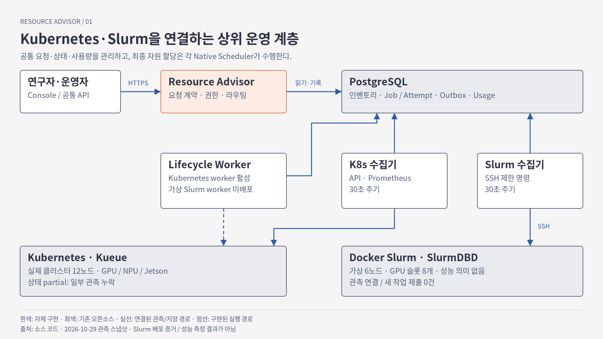
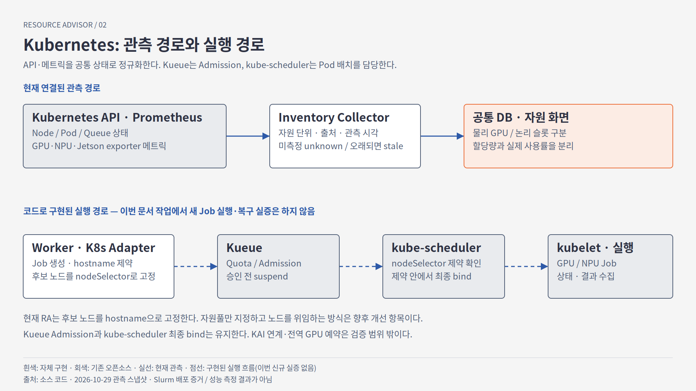
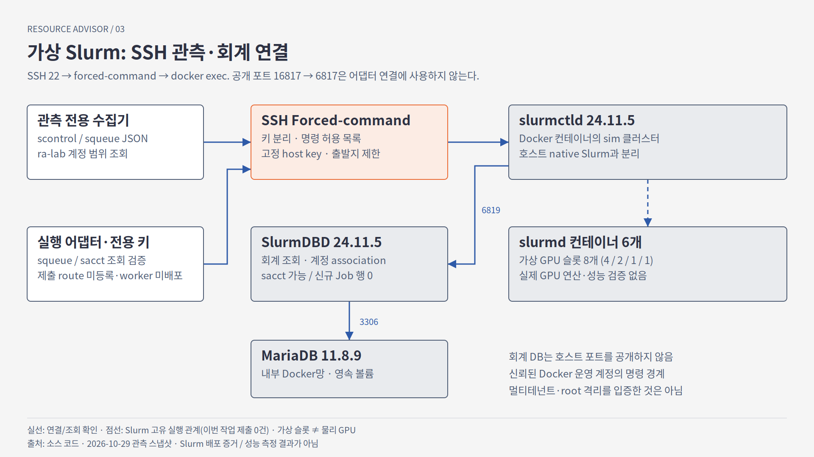

# Resource Advisor × Kubernetes × 가상 Docker Slurm 통합 아키텍처

- **기준 시각:** 2026-10-29. 현재 상태는 08:09 UTC 읽기 전용 스냅샷([evidence-snapshot.json](evidence-snapshot.json)), 상세 evidence는 06:10–07:43 UTC 기록
- **대상 브랜치:** `docs/integration-architecture-20261029` (base `0b89d6e`)
- **용도:** NAIS 연구기술직 면접 데모용 설명 문서. 시연 범위는 "관측 + 공통 계약 + 실행 경로 설계"이며 새 실행 실험은 포함하지 않는다.
- **같이 보는 자료:** [발표 노트](PRESENTATION-NOTES-KO.md) · [출처 색인](SOURCES.md) · [README](README.md)

> 이 문서의 모든 수치는 아래 링크한 코드·고정 evidence에서 가져왔다. 링크가 없는 문장은 설계 설명이다.
> 공개 문서이므로 실제 사설 IP·토큰·비밀번호·SSH fingerprint는 `<K8S_API>`, `<SLURM_HOST>`, `<ADVISOR_EGRESS_IP>`, `<RA_API>` 같은 자리표시자로 바꿨다.

---

## 1. 한 페이지 요약

**Resource Advisor(RA)는 Kubernetes와 Slurm 위에 놓인 상위 control plane이다.** 스케줄러를 새로 만들지 않고, 여러 클러스터의 GPU를 하나의 물리 풀로 합치지도 않는다.

| 질문 | 답 |
|---|---|
| RA가 하는 일 | 공통 Job 계약, 프로젝트×클러스터 route, 제출 intent의 내구 기록(PostgreSQL outbox), 불확실 제출의 reconcile, 종료 상태와 usage 장부, 클러스터 인벤토리 관측 |
| RA가 하지 않는 일 | GPU 배치 결정(K8s는 Kueue가 admission, kube-scheduler가 노드 배치를 결정하고, Slurm은 slurmctld가 결정), 전역 쿼터·공정성, 두 스케줄러의 같은 GPU 공동 소유, Slurm REST 연동 |
| 지금 실제로 돌고 있는 것 | 네임스페이스 `resource-advisor-lab`의 API, worker, Kubernetes 인벤토리 수집기, 가상 Slurm 인벤토리 수집기(모두 1/1, 08:09 UTC [evidence-snapshot.json](evidence-snapshot.json)) |
| 연결된 클러스터 | `lab-kubernetes` 12 노드(Ready 10, 스냅샷 status `partial`) · `virtual-slurm-140` 6 노드, 가상 GPU 슬롯 8개(4/2/1/1) · `lab-slurm` 2 노드(2026-10-22 이후 stale, 이력만 보존) |
| 가상 Slurm으로 가는 길 | HTTP·REST가 아니라 **SSH(22) forced-command → `docker exec --user slurm slurmctld` → `scontrol`/`squeue` JSON(v0.0.42)** |
| 가상 Slurm 실행 | **미검증.** 실행 route는 예시 설정뿐이고 API에 등록되지 않았으며 worker manifest는 `replicas: 0`이다. sbatch는 한 번도 보내지 않았다 |
| 왜 이 구조인가 | 연구기관 GPU 운영에서는 K8s(서빙·컨테이너)와 Slurm(HPC 배치)이 공존한다. 각 스케줄러의 정책은 그대로 두고, 요청·상태·사용량을 한 장부로 설명할 수 있게 한다 |

면접에서 한 문장으로 말하면 다음과 같다. "기존 스케줄러가 배치를 결정하고, RA는 누가 무엇을 요청했고 어디서 어떻게 끝났는지를 잃어버리지 않게 기록하는 계층입니다. 가상 Slurm은 현재 관측까지 연결했고, 실행은 일부러 막아 두었습니다."

---

## 2. 범위와 표기(범례)

이 문서는 상태를 네 단계로 구분한다. 면접 답변에서도 이 단어를 그대로 쓴다.

| 표기 | 의미 | 예 |
|---|---|---|
| **[배포·관측]** | 현재 lab에 배포되어 있고 live readback 또는 API 응답으로 확인함 | 가상 Slurm 인벤토리 수집기, SlurmDBD accounting |
| **[구현·미검증]** | 코드와 관련 자동 테스트는 있음. 실제 클러스터에서 그 경로로 작업이 돈 적은 없음 | 가상 Slurm 실행 route, 결과 파일 positive read |
| **[오픈소스]** | 우리가 만들지 않은 기존 구성요소. 설정·연결만 함 | Kubernetes, Kueue, Slurm 24.11.5, SlurmDBD, MariaDB, Prometheus, PostgreSQL, MLflow |
| **[계획·범위 외]** | 설계상 다음 단계이거나 의도적으로 하지 않음 | 전용 job UID, 적격 runtime 바인딩, KAI Scheduler, slurmrestd |

별도로 **[과거 기록]** 은 2026-10-07~08 등 이전 실장비 실행 기록(예: 실제 Orin Slurm 실행)이다. 이번 가상 Slurm 데모와 섞어 말하지 않는다.

---

## 3. 전체 구조



벡터 버전: [figures/01-overview.svg](figures/01-overview.svg)

### 3.1 계층별 존재 이유

| 계층 | 구성요소 | 왜 필요한가 | 만든 것 / 기존 것 |
|---|---|---|---|
| 진입 | Console(`/console`), REST API(`/api/v1/compute/...`) | 연구자·운영자가 같은 계약으로 요청·조회 | **우리 구현** ([api.py](../../../src/resource_advisor/api.py), [console.py](../../../src/resource_advisor/console.py)) — FastAPI는 오픈소스 |
| 계약 | `JobRequest`, `State`, 결과 envelope | 백엔드가 달라도 요청·상태·결과 형식이 같아야 장부가 하나가 됨 | **우리 구현** ([contracts.py](../../../src/resource_advisor/contracts.py), [service.py](../../../src/resource_advisor/service.py)) |
| 내구 기록 | PostgreSQL `ra_jobs`, `ra_outbox`, `ra_usage`, `ra_entities` | API 응답과 원격 제출 사이 장애 때 요청을 잃거나 두 번 내지 않기 위함 | 스키마·전이 규칙은 **우리 구현** ([store.py](../../../src/resource_advisor/store.py)), DB는 **오픈소스** |
| route | 프로젝트×클러스터 → 백엔드 옵션 | 한 프로젝트가 어느 큐/계정/파티션으로 가는지 설정으로 고정 | **우리 구현** ([configuration.py](../../../src/resource_advisor/configuration.py) `worker_configuration`) |
| 어댑터 | `KubernetesBackend`, `SlurmBackend` | 공통 계약을 각 스케줄러의 native 명령으로 번역 | **우리 구현** ([backends.py](../../../src/resource_advisor/backends.py)) |
| 관측 | `InventoryCollector`, `SlurmInventoryCollector` | 배치 판단 전에 "지금 무엇이 있고 얼마나 비었는지"를 시각과 함께 기록 | **우리 구현** ([inventory.py](../../../src/resource_advisor/inventory.py), [slurm_inventory.py](../../../src/resource_advisor/slurm_inventory.py)) |
| 원격 경계 | forced-command gateway | 원격 호스트에서 허용된 명령만 실행 | **우리 구현** ([slurm_observer.py](../../../examples/slurm_observer.py), [slurm_executor.py](../../../examples/slurm_executor.py)) |
| 배치·실행 | kube-scheduler, Kueue, slurmctld/slurmd, SlurmDBD | 자원 배정·큐·우선순위·회계 | **오픈소스** — 우리는 설정·조회만 |

---

## 4. 실제 배포 매핑 (2026-10-29)

현재 replica 값은 08:09 UTC 스냅샷([evidence-snapshot.json](evidence-snapshot.json))이다. revision·이미지 digest는 06:10 UTC 배포 readback([deployment-20261029.json](../../experiments/integrated-operations/evidence/deployment-20261029.json))의 **과거 기록**이며, 08:09 스냅샷이 그 값을 다시 확인한 것은 아니다.

| 단위 | 위치 | 상태 | 근거 |
|---|---|---|---|
| `ra-api` (HTTPS 8443) | K8s ns `resource-advisor-lab` | **[배포·관측]** 1/1 (08:09Z). 과거 기록: revision 96, `/healthz` 200 (06:10Z) | [evidence-snapshot.json](evidence-snapshot.json), [deployment-20261029.json](../../experiments/integrated-operations/evidence/deployment-20261029.json), [services.yaml](../../../deploy/services/services.yaml) |
| `ra-worker` | 같은 ns | **[배포·관측]** 1/1 (08:09Z) | [evidence-snapshot.json](evidence-snapshot.json) |
| `ra-inventory` (K8s 수집기, 30 s) | 같은 ns, ServiceAccount `ra-inventory` | **[배포·관측]** 1/1 (08:09Z) | [evidence-snapshot.json](evidence-snapshot.json), [services.yaml](../../../deploy/services/services.yaml), [inventory-rbac.yaml](../../../deploy/inventory-rbac.yaml) |
| `ra-virtual-slurm-140-inventory` (30 s) | 같은 ns, SA 토큰 미마운트 | **[배포·관측]** 1/1 (08:09Z) | [evidence-snapshot.json](evidence-snapshot.json), [deployment.yaml](../../../deploy/slurm-inventory-virtual-140/deployment.yaml), [inventory evidence](../../evidence/virtual-slurm-140-inventory-20261029.md) |
| `ra-virtual-slurm-140-worker` | manifest만 존재 | **[구현·미검증]** `replicas: 0`, **배포 안 됨** (`worker_deployed: false`, `api_route_registered: false`) | [worker.yaml](../../../deploy/slurm-execution-virtual-140/worker.yaml), [evidence-snapshot.json](evidence-snapshot.json) |
| `ra-slurm-worker`, `ra-slurm-inventory` (구 `lab-slurm`) | 같은 ns | 0 replicas (`ra-slurm-worker` 0/0 at 08:09Z; `lab-slurm` 인벤토리는 stale 이력만) | [evidence-snapshot.json](evidence-snapshot.json), [slurm-execution-140 evidence](../../evidence/slurm-execution-140-20261029.md) |
| PostgreSQL | Secret `ra-service-db`로 접속 | **[배포·관측]** jobs 878 / outbox 3918 / usage 876 (07:43Z) | 같은 evidence |
| Docker Slurm `sim` (가상 140) | `<SLURM_HOST>`의 Docker 네트워크 `slurmnet` | **[배포·관측]** `slurmctld` + 노드 컨테이너 6개, 모두 IDLE | [inventory evidence](../../evidence/virtual-slurm-140-inventory-20261029.md) |
| `slurmdbd` + `slurmdbd-mariadb` | 같은 `slurmnet`, 호스트 포트 publish 없음 | **[배포·관측]** 24.11.5 / MariaDB 11.8.9, named volume `ra-slurmdbd-mariadb` | [accounting README](../../../deploy/slurm-accounting-virtual-140/README.md) |
| 호스트 native Slurm `etri-slurm` | `<SLURM_HOST>` 호스트 자체 | **사용하지 않음** (다른 클러스터, 건드리지 않음) | 같은 README |

**롤아웃 방식(과거 기록, 06:10Z):** `ra-api`는 Argo Application이 없어 이미지 직접 갱신, worker는 last-applied manifest를 image-only diff로 apply(`Recreate`). 이미지 소스는 리뷰된 커밋 `53cd73b` + 기존 미추적 모듈 5개를 바이트 그대로 보존한 것으로, **커밋과 완전히 같은 이미지는 아니다** ([deployment-20261029.json](../../experiments/integrated-operations/evidence/deployment-20261029.json) `image_source`).

---

## 5. Kubernetes 쪽 구조



벡터 버전: [figures/02-kubernetes.svg](figures/02-kubernetes.svg)

### 5.1 관측

`InventoryCollector.collect` ([inventory.py](../../../src/resource_advisor/inventory.py))는 30초마다 `kubectl`로 세 가지를 읽는다.

1. `kubectl get nodes -o json` — capacity/allocatable, Ready, nodeInfo
2. `kubectl get pods --all-namespaces -o json` — 노드별 **요청량(requests) 합** (사용률 아님, `pod_request`)
3. `kubectl get --raw /apis/metrics.k8s.io/v1beta1/nodes` — metrics API

추가로 Kueue `Workload`/`LocalQueue`/`ClusterQueue`를 읽는다([queue_inventory.py](../../../src/resource_advisor/queue_inventory.py)). 권한은 [inventory-rbac.yaml](../../../deploy/inventory-rbac.yaml)의 `get`/`list`뿐이다: `nodes`, `pods`, metrics `nodes`, `clusterqueues`(get), 네임스페이스 Role로 `workloads`, `localqueues`. **쓰기 권한은 없다.**

장치 텔레메트리는 Prometheus 바인딩(`MetricBinding`: `query` + `timestamp_query`)으로 붙는다. 과거 live trial에서 DCGM GPU, Jetson GPU 사용률, Mobilint 사용률·메모리·온도를 읽은 기록이 있다([inventory.md](../../reference/inventory.md) "Actual lab evidence", [inventory-live.json](../../evidence/inventory-live.json)). 모든 값은 `signal()` 형식(`value`, `observed_at`, `source`, `status`, `unit`)으로 저장되고, 읽을 때 `fresh_view`가 시각을 다시 평가해 오래된 값은 `null` + `stale`로 바꾼다. **미측정은 0이 아니라 unknown이다.**

장치 수 해석 주의:
- 공유·time-slicing 단위(HAMi 공유 단위, `nvidia.com/gpu.shared` Jetson 슬롯)는 **논리 슬롯이지 물리 장치 수가 아니다** ([common-gpu-pool.md](../../reference/common-gpu-pool.md)).
- Jetson은 GPU와 CPU가 메모리를 공유(integrated memory)하므로 GPU 메모리를 독립 용량으로 더하지 않는다.
- NPU(Mobilint, Hailo 등)는 별도 장치 클래스다. CUDA GPU 용량에 합치지 않는다.

### 5.2 Kueue admission과 kube-scheduler placement는 다른 단계다

| 단계 | 누가 | 무엇을 결정 | RA가 보는 것 |
|---|---|---|---|
| 제출 | RA worker | `kubectl create -f -`로 Job 생성. 라벨 `kueue.x-k8s.io/queue-name`(LocalQueue), 선택적 `kueue.x-k8s.io/priority-class` | `KubernetesBackend.manifest`/`submit` ([backends.py](../../../src/resource_advisor/backends.py)) |
| admission | **Kueue** [오픈소스] | 이 Workload를 지금 들여보낼지만 결정. ClusterQueue 쿼터 안이면 쿼터를 예약하고 ResourceFlavor를 할당한 뒤 Job suspend 해제. 초과면 `QuotaReserved=False`로 **대기**(거절 아님). **Pod를 어느 노드에 둘지는 정하지 않는다** | `KubernetesBackend.admission`이 `kueue.x-k8s.io/job-uid=<UID>`로 Workload를 찾아 조건 기록 |
| placement | **kube-scheduler** [오픈소스] | admission 이후 생성된 Pod를 조건(flavor의 노드 조건, 요청량, taint 등)에 맞는 노드 하나에 bind | Pod의 노드·시각을 status로 관측만 |
| 실행·종료 | kubelet/컨테이너 런타임 | 실제 실행 | `status`/`result` |

실제 Kueue 거동 기록: 1 GPU 쿼터에 2 GPU 요청 → Job 생성은 성공, `QuotaReserved=False`로 suspend 유지, Pod 없음([kueue-policy.md](../../reference/kueue-policy.md), 2026-10-02 [과거 기록]). 이것이 Slurm QOS의 **제출 거절**과 다른 점이며, RA는 둘을 `QUOTA_OR_LIMIT_PENDING`과 `NATIVE_REJECTED`로 따로 분류한다([ARCHITECTURE.md](../../experiments/integrated-operations/ARCHITECTURE.md) Policy contract).

**KAI Scheduler는 미검증이다.** 이 저장소에 KAI 연동 코드나 실행 기록은 없다([CURRENT-STATE-AUDIT.md](../../experiments/integrated-operations/CURRENT-STATE-AUDIT.md) 4절 마지막 줄: "No scheduler algorithm, global quota, SlurmREST, OIDC, KAI…").

### 5.3 소유권 확인 (이름 재사용 대비)

Kubernetes Job 이름은 attempt ID다. 같은 이름이 삭제 후 재생성될 수 있으므로 `KubernetesBackend.owns`는 annotation `resource-advisor/job-id`, `resource-advisor/context-signature`와 제출 시 묶은 **UID**까지 일치해야 자기 Job으로 인정한다. 취소도 `DeleteOptions.preconditions.uid`로 같은 UID만 지운다([RESULTS.md](../../experiments/integrated-operations/RESULTS.md) Review round 2).

---

## 6. 가상 Docker Slurm 쪽 구조



벡터 버전: [figures/03-slurm.svg](figures/03-slurm.svg)

### 6.1 Slurm 구성요소 역할 [오픈소스]

| 구성요소 | 역할 | 가상 140에서의 실체 |
|---|---|---|
| `slurmctld` | 컨트롤러. 큐·우선순위·노드 배정 결정, RPC 6817 | 컨테이너 `slurmctld`, Slurm 24.11.5 |
| `slurmd` | 각 노드에서 job step 실행 | 컨테이너 `cpu-1`, `cpu-2`, `gpu-big`, `gpu-mid`, `gpu-s1`, `gpu-s2` |
| `slurmdbd` | accounting 데몬, 6819. `sacct`·association·QOS의 원천 | 컨테이너 `slurmdbd` (2026-10-29 추가) |
| MariaDB | slurmdbd 저장소, 3306 | 컨테이너 `slurmdbd-mariadb`, DB `slurm_acct_db` |
| munge | 노드 간 인증 | 클러스터 기존 키 재사용 |

내부 경로: `slurmctld → slurmdbd:6819 → slurmdbd-mariadb:3306`, 모두 Docker 네트워크 `slurmnet` 내부이며 **DB 계열 포트는 호스트에 publish하지 않았다**([accounting README](../../../deploy/slurm-accounting-virtual-140/README.md)).

호스트에는 `16817 → 컨테이너 6817` publish가 이미 존재하지만, **RA 어댑터는 이 포트를 쓰지 않는다.** HTTP도, Slurm RPC 직접 연결도 하지 않는다. `slurmrestd`는 설치·사용되지 않았다. RA가 가상 Slurm에 닿는 유일한 경로는 SSH 22번의 forced-command다.

### 6.2 관측 경로 [배포·관측]

1. `ra-virtual-slurm-140-inventory` Pod가 30초마다 `SlurmInventoryCollector.collect` 실행 ([slurm_inventory.py](../../../src/resource_advisor/slurm_inventory.py)).
2. `read()`가 `ssh -o BatchMode=yes -o StrictHostKeyChecking=yes -o ConnectTimeout=5 ra-virtual-slurm-140-observer '<명령>'` 실행. 호스트 키는 Secret의 `known_hosts`에 고정.
3. `<SLURM_HOST>`의 `authorized_keys`가 이 키를 `restrict,from="<ADVISOR_EGRESS_IP>"`와 forced command `slurm_observer.py --config …`로 묶는다. 클라이언트가 보낸 명령은 `SSH_ORIGINAL_COMMAND`로만 전달된다.
4. `observe()` ([slurm_observer.py](../../../examples/slurm_observer.py))가 **정확히 두 가지 명령**만 허용한다.
   - `scontrol --json=v0.0.42 show nodes`
   - `squeue --json=v0.0.42 --account=ra-lab --partition=all`
5. 허용되면 `/usr/bin/docker exec --user slurm slurmctld /usr/bin/<cmd> …`로 실행(환경 `PATH=/usr/bin:/bin`, 15 s timeout).
6. 응답 검증: `data_parser/v0.0.42`, release `24.11.5`, 8 MiB·10,000행 상한, 허가된 노드 6개가 정확히 있는지, 큐 행이 `ra-lab`/`all` 밖으로 새지 않는지. 허용 필드만 남겨(`NODE_FIELDS`, `JOB_FIELDS`) 반환.
7. 수집기가 다시 같은 검증을 하고 `node_view`/`queue_view`로 스냅샷을 만들어 `save_inventory` → `ra_entities`(kind `inventory`)에 저장.
8. Console·API는 `latest_inventory_views`/`latest_inventory`로 최신 스냅샷을 읽고 `fresh_view`로 신선도를 재평가한다.

`scontrol` 노드 TRES에 `gres/gpu`가 없어서 GPU 슬롯 수는 노드의 `gres` 등록값에서 읽는다([inventory README](../../../deploy/slurm-inventory-virtual-140/README.md)).

### 6.3 Accounting [배포·관측]

- `slurm.conf`에 네 줄 추가: `AccountingStorageType=accounting_storage/slurmdbd`, `AccountingStorageHost=slurmdbd`, `AccountingStoragePort=6819`, `AccountingStorageTRES=gres/gpu`.
- association: cluster `sim`, account `ra-lab`, user `slurm`, 기본 QOS `normal`. **`AccountingStorageEnforce`는 `none` 그대로** — 즉 회계 기록만 켰고 쿼터 강제는 바꾸지 않았다.
- 확인: `sacctmgr show cluster` 등록, `sacct -X` exit 0 / 0행, MariaDB·slurmdbd 재시작 후 association 유지, `sdiag` DBD agent queue 0 ([slurm-execution-140 evidence](../../evidence/slurm-execution-140-20261029.md)).

ClusterID 전환 사건(요약): 첫 전환에서 컨트롤러 state의 ID 623과 DBD가 새로 부여한 ID 927이 맞지 않아 약 90초 crash-loop → `slurm.conf` 복원으로 롤백. 이후 승인을 받아 identity 파일 `clustername`만 옆으로 옮기고(삭제 아님) 다시 적용, ID 927 채택. 백업 보존, `NEXT_JOB_ID=3` 유지, 큐는 처음부터 끝까지 비어 있었다. 상세는 같은 evidence의 "Incident during the switch". 발표 본론은 아니며 질문이 오면 설명한다.

### 6.4 실행 경로 [구현·미검증 — 실행 불가 상태로 고정]

| 항목 | 상태 |
|---|---|
| worker route `ra-lab`/`virtual-slurm-140` | [worker-route.example.json](../../../deploy/slurm-execution-virtual-140/worker-route.example.json) **예시 파일**. 실제 worker 설정·API에 등록되지 않음 |
| worker Deployment | [worker.yaml](../../../deploy/slurm-execution-virtual-140/worker.yaml) `replicas: 0`, 배포 안 됨 |
| `native_runtimes` (worker) | `{}` → `SlurmBackend.validate`가 SSH 이전에 거부 |
| `native_bindings`/`training_bindings` (gateway) | `[]` → `batch()`가 `native runtime is not enabled`로 Docker 호출 전에 거부 |
| job UID | 전용 비특권 UID 없음. 실행된다면 `SlurmUser`인 `slurm`으로 돈다 |
| 제출 이력 | sbatch 0건, `NEXT_JOB_ID` 3 유지, RA DB의 `virtual-slurm-140` 관련 jobs/outbox/usage 0 |
| executor/results 키 | 설치됨, **읽기 전용 확인만**: `squeue`/`sacct` 허용 형식 exit 0·0행, 그 외 명령은 거부 |
| 결과 파일 positive read | **미검증** (읽을 job 출력이 없음) |

두 거부 지점은 `tests/test_slurm_executor.py::test_committed_virtual_140_route_and_gateway_cannot_submit`가 테스트한다. 거부를 증명하려고 live sbatch를 보낸 적도 없다.

**기존 Slurm backend와의 구분:** `SlurmBackend` 코드 자체와 과거 실제 Orin/VM Slurm 실행 기록(예: [slurm-jetson-runtime-results.md](../../reference/slurm-jetson-runtime-results.md), [slurm-vm.md](../../reference/slurm-vm.md))은 [과거 기록]이며 다른 클러스터다. "가상 140에서 실행이 된다"는 근거로 쓰지 않는다.

---

## 7. 프로토콜·인증·방향·payload

| # | 출발 → 도착 | 프로토콜/포트 | 인증 | 방향 | payload | 상태 |
|---|---|---|---|---|---|---|
| P1 | Client/Console → `ra-api` | HTTPS 8443 | `Authorization: Bearer` (설정된 credential 해시와 비교, `principal`) | 요청/응답 | JSON (`JobRequest`, 조회 결과) | 배포 |
| P2 | `ra-api`·worker·수집기 → PostgreSQL | PostgreSQL 프로토콜 | Secret `ra-service-db`의 URL | 양방향 | SQL, JSON body | 배포 |
| P3 | `ra-inventory` → `<K8S_API>` | HTTPS (kubectl) | ServiceAccount `ra-inventory` 토큰, ClusterRole get/list | 읽기 | Node/Pod/metrics/Kueue JSON | 배포 |
| P4 | `ra-inventory` → Prometheus | HTTP(S) | 선택적 토큰 env(`prometheus_token_env`), URL에 자격증명 금지 | 읽기 | PromQL 결과 + timestamp | 바인딩 시 |
| P5 | `ra-worker` → `<K8S_API>` | HTTPS (kubectl) | worker 전용 권한 | 쓰기(create/delete Job)·읽기 | Job manifest JSON | 배포 (이번 업데이트 중 새 GPU job 없음) |
| P6 | 가상 Slurm 수집기 → `<SLURM_HOST>` | SSH 22 | ed25519 키, `restrict`, `from="<ADVISOR_EGRESS_IP>"`, 고정 host key | 읽기 | 2개 명령 문자열 → 필터된 JSON | 배포 |
| P7 | forced command → `slurmctld` 컨테이너 | 로컬 `docker exec` (Docker socket) | 호스트 운영 계정 `etri`(docker 그룹) | 로컬 | argv | 배포 |
| P8 | `slurmctld` → `slurmdbd` → MariaDB | Slurm RPC 6819 / MySQL 3306 | munge / DB 비밀번호(호스트 0700 디렉터리) | 내부 | accounting 레코드 | 배포 |
| P9 | (예정) worker → `<SLURM_HOST>` executor 키 | SSH 22 | 별도 키 `ra-virtual-slurm-140-executor`, `restrict,from=` | 쓰기 후보 | `sbatch --parsable` + stdin 스크립트, `squeue`/`sacct`/`scancel` 고정 형식 | **구현·미검증**, 현재 sbatch는 거부 |
| P10 | (예정) worker → results 키 | SSH 22 | 별도 키 `ra-virtual-slurm-140-results` | 읽기 | `tail -c 65537|16384 -- /jobs/ra-lab/<attempt>.log` | 설치·거부 확인만 |
| P11 | worker → 객체 저장소·MLflow | HTTPS | 설정된 자격증명 | 쓰기 | 결과 아티팩트, run 기록 | 코드 경로 존재. 현재 실행마다 검증된 것으로 가정하지 않음 |
| — | 호스트 `16817 → 6817` | TCP | — | — | — | **존재하지만 RA는 사용 안 함** |

---

## 8. 관측 시퀀스 (가상 Slurm, 30초 주기)

```text
t0  ra-virtual-slurm-140-inventory: collect()
t0  ├─ ssh … ra-virtual-slurm-140-observer 'scontrol --json=v0.0.42 show nodes'
    │    └─ <SLURM_HOST> sshd → slurm_observer.py → docker exec --user slurm slurmctld scontrol …
    │       └─ 6개 노드만 남기고 NODE_FIELDS 필터 → JSON
t0  ├─ ssh … 'squeue --json=v0.0.42 --account=ra-lab --partition=all'
    │    └─ ra-lab/all 행만, JOB_FIELDS 필터 ("Zero jobs to dump" 경고는 정상 빈 결과로 인정)
t0  ├─ snapshot.sources = {slurm_nodes, slurm_queue, prometheus}
    ├─ 어느 하나라도 ok가 아니면 status = partial
    └─ save_inventory → ra_entities(kind=inventory, project=ra-lab, cluster_ref=virtual-slurm-140)
t0+ heartbeat 파일 갱신 → readinessProbe(check-heartbeat --max-age 120)
읽기 Console/API → latest_inventory_views → fresh_view(stale_after_seconds 기본 120)
```

2026-10-29 07:06:50Z 스냅샷 결과: `slurm_nodes: ok`, `slurm_queue: ok`(ra-lab/all 범위 0행 — **전체 클러스터 큐가 아님**), `prometheus: not_configured` → **status `partial`**. "partial"은 장애가 아니라 **메트릭 관측이 연결되지 않았다**는 뜻이다. 노드 전부가 offline이라는 의미도 아니다([inventory evidence](../../evidence/virtual-slurm-140-inventory-20261029.md)). 08:08:42Z 스냅샷에서도 status는 `partial`이었다([evidence-snapshot.json](evidence-snapshot.json)).

---

## 9. 공통 Job 흐름 (개념도 — 가상 Slurm 제출은 비활성)

아래는 RA가 **Kubernetes route와 기존 Slurm route에서 쓰는** 흐름이다. 가상 140 route에서는 6단계의 원격 호출 전에 `validate`에서 막힌다.

| 단계 | 일어나는 일 | 코드 | 장애 시 |
|---|---|---|---|
| 1. 접수 | `POST /api/v1/compute/jobs` + `Idempotency-Key` 헤더 | `api.submit` → `Service.submit` ([service.py](../../../src/resource_advisor/service.py)) | 같은 키+같은 body는 같은 job 재반환, 다른 body는 Conflict |
| 2. intent 기록 | 한 트랜잭션에 `VALIDATED` job, `attempt_id`(`a-…`), outbox `submit-<attempt>` | `store.enqueue` | 커밋 전 실패면 아무것도 없음 |
| 3. lease | route가 맞는 worker만 이벤트를 가져감 (`FOR UPDATE SKIP LOCKED`, lease token) | `store.claim(job_routes=…)`, `store.job_route_filter` | lease 만료 시 다른 시도가 이어받음, stale finish는 token으로 차단 |
| 4. 사전 검증 | 호환성·승인·deadline·`backend.validate` | `Worker.submit_one` | 원격 호출 전 실패는 `FAILED`(`PRE_SUBMISSION_*`) — **가상 140은 여기서 멈춤** |
| 5. 제출 의도 커밋 | `SUBMITTING`을 먼저 커밋 | `Worker.submit_one` | 이후 crash는 재제출이 아니라 reconcile 대상 |
| 6. native 호출 | K8s: `kubectl create`; Slurm: `sbatch --parsable`(SSH forced-command) | `KubernetesBackend.submit`, `SlurmBackend.submit` | 응답 손실·timeout → `SUBMISSION_UNKNOWN`; 허용 목록에 있는 거절 문구만 `FAILED`(`native_rejection`) |
| 7. native ID | `QUEUED` + `external_id`(K8s 이름+UID, Slurm job ID) | `native_name`, `SlurmBackend.external_id` | — |
| 8. reconcile | 불확실하면 attempt 이름으로 찾음. K8s: `get job <attempt>` + 소유권; Slurm: `squeue --name`/`sacct --name … --duplicates` | `Worker.reconcile_submission`, `*.reconcile` | `MATCHED` 채택 / `NO_MATCH`·`AMBIGUOUS`·`QUERY_FAILED`는 열린 상태 유지 |
| 9. 상태 추적 | `RUNNING`, Kueue 조건, Slurm `%r` 대기 사유 | `Worker.reconcile_all`, `status`, `admission` | 조회 실패는 unknown이지 부재가 아님 |
| 10. 결과 | 결과 envelope 수집(K8s 로그, Slurm results 키의 bounded tail) → 검증 | `result`, `result_from_log` | 형식 불일치 → `RESULT_INVALID` |
| 11. 종료+usage | 종료 상태와 `ra_usage` 1행을 **같은 트랜잭션**에 기록, attempt가 PK | `store.change_job` → `record_usage`, [accounting.py](../../../src/resource_advisor/accounting.py) `ledger_record` | 재실행·backfill은 새 행을 만들지 않음 |
| 12. 게시 | 아티팩트·MLflow 전달(outbox) | `MLflowDelivery` ([worker.py](../../../src/resource_advisor/worker.py)), [artifacts.py](../../../src/resource_advisor/artifacts.py) | 전달 실패는 재시도, 결과 상태와 분리 |

조회: `GET /jobs/{id}`, `GET /jobs/{id}/lifecycle`(reconcile 이력 최근 10개, 연속 no-match 수), `GET /usage/report?month=YYYY-MM`. 운영자는 `POST /jobs/{id}/submission-resolution`(`ACKNOWLEDGE_UNRESOLVED`)로 **감사 기록만** 남긴다. 이 조치는 job을 종료시키거나 usage를 쓰지 않고, 늦게 나타난 native job은 여전히 채택된다([ARCHITECTURE.md](../../experiments/integrated-operations/ARCHITECTURE.md) Lifecycle contract).

**현재 미해결:** 2026-10-28 `live-k8s-cpu`의 `SUBMISSION_UNKNOWN` 2건이 열려 있다. acknowledge하지 않았고 테스트 job으로 재사용하지도 않았다([deployment-20261029.json](../../experiments/integrated-operations/evidence/deployment-20261029.json) `pre_existing_unresolved`). 따라서 **"zero-loss가 증명됐다"고 말하지 않는다.** 말할 수 있는 것은 "불확실한 제출을 성공이나 실패로 둔갑시키지 않고 열어 둔다"는 설계다.

---

## 10. 공통 엔티티 키와 상태 의미

| 키 | 의미 | 출처 |
|---|---|---|
| `project` | 권한·쿼터 매핑 단위. Bearer credential이 프로젝트 하나에 묶임 | `Principal`, [configuration.py](../../../src/resource_advisor/configuration.py) `principals` |
| `cluster` / `cluster_ref` | route와 인벤토리의 클러스터 이름 (`lab-kubernetes`, `virtual-slurm-140`, `lab-slurm`) | worker route, `TelemetryConfig.cluster_ref` |
| `node_ref` | RA 쪽 노드 별칭. 가상 140은 `virtual-slurm-140-` 접두사 + `node_names`로 Slurm 이름 매핑 | `SlurmInventoryConfig.slurm_scope` |
| `job_id` (`j-…`) | 논리 job. 재시도해도 같음 | `service.submit` |
| `attempt_id` (`a-…`) | 실제 제출 1회. **K8s Job 이름 = Slurm job 이름 = usage PK** | 같은 곳 |
| `external_id` | native ID (K8s 이름+UID, Slurm job ID) | `native_name` |
| `idempotency_key` | `(project, key)` 유일 | `ra_jobs` |

상태: `RECEIVED → VALIDATED → SUBMITTING → (SUBMISSION_UNKNOWN) → QUEUED → RUNNING → COLLECTING → SUCCEEDED | FAILED | RESULT_INVALID | CANCELED`, 취소 경로 `CANCEL_REQUESTED` ([contracts.py](../../../src/resource_advisor/contracts.py) `State`). 모든 전이는 version CAS로 늦은 응답이 최신 상태를 되돌리지 못하게 한다(`store.change_job`).

unknown 원칙:
- 관측: `status ∈ {ok, unavailable, stale, invalid_time, not_configured}`. ok가 아니면 `value=null`.
- 큐: 조회 실패는 "큐가 비었다"가 아니다.
- reconcile: `NO_MATCH`도 부재 증명이 아니다(SlurmDBD 지연·조회 범위).
- usage: 구간을 모르면 0이 아니라 "unknown"으로 별도 집계.

---

## 11. 쿼터·사용량 매핑

### 11.1 쿼터는 native가 소유한다

| RA route 값 | Kubernetes | Slurm(가상 140) |
|---|---|---|
| 큐 | `local_queue` → Kueue LocalQueue → ClusterQueue 쿼터 | `partition: all` |
| 회계 단위 | (네임스페이스/큐) | `account: ra-lab` |
| 우선순위 | `kueue.x-k8s.io/priority-class` (WorkloadPriorityClass) | `qos: normal` |
| 강제 | Kueue admission | `AccountingStorageEnforce=none` (현재 강제 없음) |

route drift 방지: 계획(`scheduling_plan`)이 저장된 job은 실제 어댑터 값이 다르면 `verify_adapter_plan`이 `SCHEDULING_BINDING_DRIFT`로 제출 전에 거부한다([scheduling.py](../../../src/resource_advisor/scheduling.py)). RA는 **전역 쿼터를 추가하지 않는다.**

### 11.2 usage 단위

- 기록 대상은 **native evidence로 관측된 예약량**이다: K8s는 스케줄된 컨테이너 requests + Pod 시각, Slurm은 `sacct` `AllocTRES` + 시작/종료 시각. 요청량도 사용률도 아니다.
- `allocation_mode`(`physical_device`, `virtual_slot`, `cpu_only`), 장치 클래스, 모델, 클러스터, 자원 키는 **합치지 않는다.** 환율을 만들지 않는다.
- 가상 140의 `gres/gpu` 시간은 **virtual-slot 시간**이다. `gres/gpumem`, `gres/gpuutil`은 Slurm이 자동 등록했지만 `JobAcctGatherType`이 없어 측정되지 않는다 → unknown.
- `/usage/report`는 `[start, end)` UTC로 구간을 자르고, 끝나지 않은 attempt는 `not_finalized`로 따로 나열한다([accounting.py](../../../src/resource_advisor/accounting.py) `period_report`).

### 11.3 비트랜잭션 외부 작업, TOCTOU, 멱등성

- **외부 작업은 트랜잭션 밖이다.** DB 커밋과 `sbatch`/`kubectl create`를 원자적으로 묶을 수 없다. 그래서 "의도 먼저 커밋 → 호출 → 결과 기록" 순서와 reconcile로 보완한다.
- **TOCTOU:** 인벤토리에서 "비어 있다"고 본 순간과 native 스케줄러가 배정하는 순간 사이에 상태가 바뀐다. 인벤토리는 **배치 권한이 아니다**(`execution_qualification: "inventory never grants runtime qualification or admission"`). 최종 판단은 Kueue/slurmctld가 한다.
- **멱등성:** API는 `(project, Idempotency-Key)`, 제출은 attempt 이름, usage는 attempt PK. 단, Slurm 쪽 이름 검색은 SlurmDBD가 있어야 응답 손실을 안전하게 복구할 수 있다(`SlurmBackend.reconcile` 주석). 가상 140에 SlurmDBD를 붙인 이유 중 하나다.
- **동시성:** CAS·lease·`SKIP LOCKED`는 테스트로 확인했지만 운영 자격은 **route당 worker 1 replica**(`Recreate`)다. HA 주장이 아니다.

---

## 12. 보안 경계

| 경계 | 무엇으로 | 무엇을 막는가 | 막지 못하는 것 |
|---|---|---|---|
| API | Bearer credential(해시 비교), 프로젝트 범위, 운영자 플래그+subject | 다른 프로젝트 조회·제출, 비운영자의 resolution | credential 유출 |
| 수집기 Pod | `runAsNonRoot` 10001, `readOnlyRootFilesystem`, `capabilities: drop ALL`, seccomp `RuntimeDefault`; 가상 Slurm 수집기는 SA 토큰 미마운트 | Pod 내 권한 상승, K8s API 접근(가상 Slurm 수집기) | — |
| K8s 수집기 RBAC | get/list만 | 쓰기 | 클러스터 전체 Pod 목록 읽기는 가능(요청량 계산용) |
| SSH 키 | `restrict`(포워딩·pty 금지), `from="<ADVISOR_EGRESS_IP>"`, 고정 `known_hosts`, `BatchMode` | 다른 출발지, 셸, 포트 포워딩(실측: administratively prohibited) | 출발 IP를 공유하는 다른 Pod |
| forced command | 명령 화이트리스트, 계정/파티션 고정 인자, 출력 필드 필터 | `id`, `bash -i`, `sinfo`, `docker ps`, `sbatch`(observer), `; id` 연결, 타 계정 조회 (모두 실측 거부) | — |
| 키 분리 | observer / executor / results 3개 키 | 관측 키로 제출, 결과 키로 스케줄러 명령 | — |
| 결과 파일 | 경로 `/jobs/ra-lab/<REF>.log`만, `O_NOFOLLOW`, 정규 파일, 소유자 UID 64030(`slurm`), 64 KiB/16 KiB tail | symlink 탈출, 범위 밖 파일, 대용량 읽기 | positive read는 미검증 |
| 운영 계정 | gateway 파일 소유 `etri`, 0700/0600 | — | **`etri`는 docker 그룹 = 그 호스트에서 root와 동등.** root 소유 격리 경계가 아니라 "신뢰된 계정 하나의 명령 경계"다 |
| job 실행 UID | (없음) | — | 실행 시 `slurm`으로 돎. 전용 비특권 UID가 생기기 전에는 실행 금지 |

참고: [slurm_observer.py](../../../examples/slurm_observer.py) docstring은 "Root-owned forced-SSH command"라고 쓰지만, 가상 140 배포에서는 `etri` 소유로 설치했다([inventory README](../../../deploy/slurm-inventory-virtual-140/README.md) Transport). 발표에서 root 소유·격리라고 말하지 않는다. 기존 상태 그대로인 `shared/munge.key` 0644도 한계로 기록돼 있다.

---

## 13. 노드·장치 인벤토리 (evidence 시점 값, live 메트릭 아님)

| 클러스터 | 노드 | 장치/슬롯 | 상태 | 시점·근거 |
|---|---|---|---|---|
| `lab-kubernetes` | 12 (Ready 10) | 물리 GPU `nvidia.com/gpu` 3 · Jetson 공유 슬롯 `nvidia.com/gpu.shared` 6(노드 3개×2, 그중 1노드 NotReady) · NPU 5(`hailo.ai/h8` 2, `rockchip.com/rk3399pro` 1(NotReady 노드), `npu.intel.com/accel` 1, `mobilint.com/npu` 1) · 가속기 없는 노드 2 | partial | 08:08:40Z, [evidence-snapshot.json](evidence-snapshot.json) |
| `virtual-slurm-140` | 6 (IDLE, 07:06Z) | `cpu-1`,`cpu-2`: 4 CPU/2000 MiB · `gpu-big` 4 CPU, 슬롯 4 · `gpu-mid` 4 CPU, 슬롯 2 · `gpu-s1`,`gpu-s2` 2 CPU/1000 MiB, 슬롯 1씩 → **가상 GPU 슬롯 8, 예약 0** | partial (메트릭 미연결) | 08:08:42Z [evidence-snapshot.json](evidence-snapshot.json) (슬롯 수 동일); CPU·메모리·IDLE은 07:06:50Z [inventory evidence](../../evidence/virtual-slurm-140-inventory-20261029.md) |
| `lab-slurm` | 2 | — | **stale** (마지막 수집 2026-10-22T07:55Z), 이력만 | [evidence-snapshot.json](evidence-snapshot.json) |

위 값은 스냅샷 시점의 **등록 용량**이며 사용률이 아니다. 공유 슬롯 6은 물리 GPU 6이 아니고, AGX 노드는 실행 대상에서 제외돼 있다. 스냅샷의 Slurm 노드 `ready`는 null인데, Slurm 노드에는 Kubernetes Ready 조건이 없기 때문이다(노드 상태는 Slurm `state`로 따로 기록).

가상 GPU는 컨테이너 안에서 `/dev/null`을 `/dev/nvidiaN`으로 매핑한 것이다. Slurm은 `gpu:a100`이라고 보고하지만 **물리 GPU가 아니며 A100 성능 주장은 없다.** RA는 이를 `device_class: gpu`, `allocation_mode: virtual_slot`으로 분류하고 Console에 "공유 슬롯"으로 표시한다. Console 헤더의 "GPU 등록 노드"는 가상 슬롯 노드 4개를 등록 수로 센다(프론트엔드 미변경, 한계로 기록).

---

## 14. 한계 매트릭스

| 영역 | 현재 | 말해도 되는 것 | 말하면 안 되는 것 |
|---|---|---|---|
| 가상 Slurm 관측 | 배포·관측 | 6노드·8슬롯을 30초마다 수집, partial | 실시간 사용률, 전체 클러스터 큐 |
| 가상 Slurm accounting | 배포·관측 | SlurmDBD로 `sacct` 가능, association 존재 | 쿼터 강제 중, job 회계 검증 완료 |
| 가상 Slurm 실행 | 구현·미검증 | 경로 설계·gateway 거부 테스트 | job이 돌았다, 결과 파일을 읽었다 |
| K8s 실행 | 배포 | worker 1/1, 과거 GPU 실행 기록 | 이번 업데이트에서 새 GPU job·재시작 복구 실험을 했다 |
| 새 native job | 0건 | — | smoke 성공 (smoke는 `NOT_RUN`) |
| 불확실 제출 | 2건 미해결 | 열어 두는 설계, 테스트 케이스 | zero-loss 증명 |
| 동시성 | 테스트만 | CAS·lease·SKIP LOCKED 테스트 | HA, 다중 worker 운영 |
| 보안 | 명령 경계 | 화이트리스트·키 분리·실측 거부 | root 격리, 멀티테넌트 격리 |
| GPU 의미 | 가상 슬롯 | 스케줄러 등록 슬롯 | 물리 GPU, A100 성능 |
| 스케줄러 | 기존 것 사용 | Kueue admission, slurmctld 배정 | RA가 GPU를 배치, KAI 연동 |
| 아티팩트·MLflow | 코드 경로 | 구현된 전달 경로 | 현재 모든 실행이 검증됨 |
| 정책 금지 | — | CPU job 금지, AGX 제외, 새 native job 0 | — |

과거 사건 하나도 기록해 둔다. UID precondition 확인 중 `kubectl delete --raw …?dryRun=All`이 dry run으로 동작하지 않아 완료된 2026-10-28 live-training Job 1개와 Pod가 삭제됐다. DB job·usage 행은 그대로이고 native 객체와 Pod 로그는 복구할 수 없다([RESULTS.md](../../experiments/integrated-operations/RESULTS.md) Live phase). 그 뒤로 live에서 파괴적 확인 시험을 하지 않는다.

---

## 15. 코드 소스 맵

| 관심사 | 파일 | 주요 함수/클래스 |
|---|---|---|
| HTTP 경로·인증 | [api.py](../../../src/resource_advisor/api.py) | `create_app`, `principal`, `operator`, `submit`, `inventory`, `console_overview`, `usage_report`, `job_lifecycle`, `resolve_submission` |
| Console 읽기 모델 | [console.py](../../../src/resource_advisor/console.py) | `overview` (`latest_inventory_views` 사용) |
| 접수·멱등성 | [service.py](../../../src/resource_advisor/service.py) | `submit`, `resolve_submission` |
| 계약·상태 | [contracts.py](../../../src/resource_advisor/contracts.py) | `State`, `JobRequest` |
| 저장·outbox | [store.py](../../../src/resource_advisor/store.py) | `ra_jobs`/`ra_outbox`/`ra_usage`/`ra_entities`, `claim`, `finish`, `change_job`, `record_usage`, `job_route_filter` |
| worker | [worker.py](../../../src/resource_advisor/worker.py) | `Worker.submit_one`, `reconcile_submission`, `cancel_one`, `reconcile_all`, `MLflowDelivery` |
| 어댑터 | [backends.py](../../../src/resource_advisor/backends.py) | `KubernetesBackend` (`manifest`, `submit`, `owns`, `reconcile`, `admission`, `cancel`), `SlurmBackend` (`call`, `validate`, `submit`, `reconcile`, `status`, `accounting`), `native_rejection`, `SubmissionUnknown`/`Rejected`/`Ambiguous` |
| route 설정 | [configuration.py](../../../src/resource_advisor/configuration.py) | `worker_configuration`, `principals`, `check_configuration` |
| 계획 검증 | [scheduling.py](../../../src/resource_advisor/scheduling.py) | `compile_plan`, `verify_adapter_plan` |
| K8s 인벤토리 | [inventory.py](../../../src/resource_advisor/inventory.py), [queue_inventory.py](../../../src/resource_advisor/queue_inventory.py) | `InventoryCollector.collect`, `signal`, `fresh_view`, `save_inventory`, `latest_inventory(_views)` |
| Slurm 인벤토리 | [slurm_inventory.py](../../../src/resource_advisor/slurm_inventory.py) | `SlurmController`, `SlurmInventoryConfig`, `SlurmInventoryCollector.read/node_view/queue_view/collect` |
| 사용량 | [accounting.py](../../../src/resource_advisor/accounting.py) | `ledger_record`, `summarize`, `month_period`, `period_report` |
| gateway | [slurm_observer.py](../../../examples/slurm_observer.py), [slurm_executor.py](../../../examples/slurm_executor.py) | `observe`; `plan`, `scheduler_plan`, `batch`, `containerized`, `main` |
| 배포 | [services](../../../deploy/services/services.yaml), [inventory-virtual-140](../../../deploy/slurm-inventory-virtual-140/), [accounting-virtual-140](../../../deploy/slurm-accounting-virtual-140/), [execution-virtual-140](../../../deploy/slurm-execution-virtual-140/) | — |

### 15.1 읽기 전용 점검 명령 (자리표시자 사용)

```sh
# K8s: 배포 상태 (읽기)
kubectl -n resource-advisor-lab get deploy ra-api ra-worker ra-inventory ra-virtual-slurm-140-inventory ra-virtual-slurm-140-worker
kubectl -n resource-advisor-lab logs deploy/ra-virtual-slurm-140-inventory --tail=50

# API: 최신 인벤토리·개요 (토큰은 환경변수, 화면·문서에 출력 금지)
curl -sS -H "Authorization: Bearer $RA_TOKEN" https://<RA_API>/api/v1/compute/inventory/virtual-slurm-140
curl -sS -H "Authorization: Bearer $RA_TOKEN" https://<RA_API>/api/v1/compute/overview
curl -sS -H "Authorization: Bearer $RA_TOKEN" "https://<RA_API>/api/v1/compute/usage/report?month=2026-10"

# 가상 Slurm: observer 키가 허용하는 두 읽기만 (다른 명령은 거부되는 것이 정상)
ssh ra-virtual-slurm-140-observer 'scontrol --json=v0.0.42 show nodes'
ssh ra-virtual-slurm-140-observer 'squeue --json=v0.0.42 --account=ra-lab --partition=all'
```

점검 중 하지 말 것: `sbatch`·`scancel`, worker `replicas` 변경, `kubectl delete`(특히 `--raw`의 `dryRun` 신뢰 금지), `slurmctld` 재시작.

---

## 16. 면접 예상 질문 12개

1. **RA가 스케줄러인가요?** 아닙니다. Kubernetes에서는 Kueue가 admission(들여보낼지)을, kube-scheduler가 노드 배치를 정하고, Slurm에서는 slurmctld가 정합니다. RA는 요청·상태·사용량을 잃지 않게 하는 상위 control plane입니다.
2. **K8s와 Slurm GPU를 하나의 풀로 합쳤나요?** 아닙니다. 한 GPU를 두 스케줄러가 같이 소유하지 않고, 장부와 화면에서만 나란히 보여 줍니다. 장치 클래스·할당 방식도 합산하지 않습니다.
3. **Slurm에 왜 REST가 아니라 SSH인가요?** 이 환경에 slurmrestd가 없고, forced-command로 허용 명령을 코드 수준에서 제한하는 편이 범위를 좁히기 쉬웠습니다. 16817 포트가 열려 있어도 쓰지 않습니다. REST 전환은 범위 밖입니다.
4. **가상 Slurm에서 작업이 돌았나요?** 아닙니다. 관측과 accounting까지 확인했습니다. 실행 route는 예시 설정이고 worker는 0 replica이며 sbatch는 0건입니다. 전용 job UID와 적격 runtime이 생기기 전에는 실행하지 않습니다.
5. **가상 GPU 8개는 무엇인가요?** Slurm GRES에 등록된 슬롯입니다. 장치는 `/dev/null` 매핑이라 성능 의미가 없고, RA는 `virtual_slot`으로 분류합니다.
6. **응답이 사라지면 중복 제출되나요?** 원격 호출 전에 `SUBMITTING`을 커밋하고, 불확실하면 attempt 이름으로 reconcile합니다. 재제출하지 않습니다. 다만 미해결 2건이 남아 있어 zero-loss를 증명했다고는 말하지 않습니다.
7. **Kueue 쿼터 초과와 Slurm 거절의 차이는?** Kueue는 Job을 만들고 admission을 보류합니다. Slurm QOS 위반은 제출 자체를 거절합니다. RA는 앞의 것을 대기로, 뒤의 것을 허용 목록 문구일 때만 거절로 분류합니다.
8. **사용량은 실제 사용률인가요?** 아닙니다. native가 기록한 예약량(K8s requests+시각, Slurm AllocTRES+시각)입니다. 모르는 구간은 0이 아닌 unknown으로 남깁니다.
9. **보안 경계는 충분한가요?** 명령 화이트리스트·키 분리·출발지 제한·host key 고정은 실측으로 거부를 확인했습니다. 하지만 gateway 소유 계정이 docker 그룹이라 root 격리는 아닙니다.
10. **status가 partial인데 장애인가요?** 아닙니다. 노드·큐 관측은 ok이고 Prometheus 메트릭이 연결되지 않았다는 뜻입니다.
11. **ClusterID 사건은 무엇이었나요?** accounting 전환 때 ID 불일치로 약 90초 컨트롤러 재시작 루프가 있었고 즉시 롤백했습니다. 큐는 비어 있었고 job counter와 백업은 보존됐습니다. 원인을 소스에서 확인한 뒤 identity 파일만 옮겨 다시 적용했습니다.
12. **다음 단계는?** 전용 비특권 job UID, 적격 runtime 바인딩, 그다음 2분 이하 smoke 1건과 응답 손실 복구 시험입니다. 그 전에는 데모 범위를 관측으로 한정합니다.

---

## 17. 출처

전체 목록과 각 출처의 증거 수준은 [SOURCES.md](SOURCES.md)에 정리했다.
