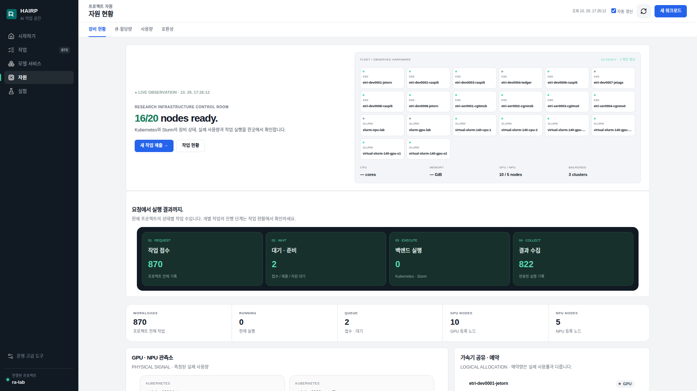
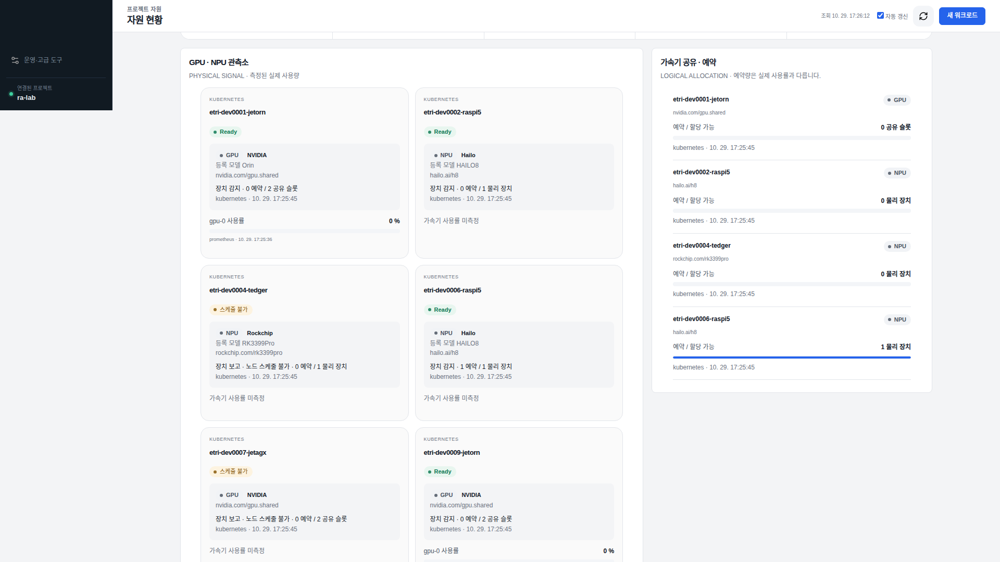
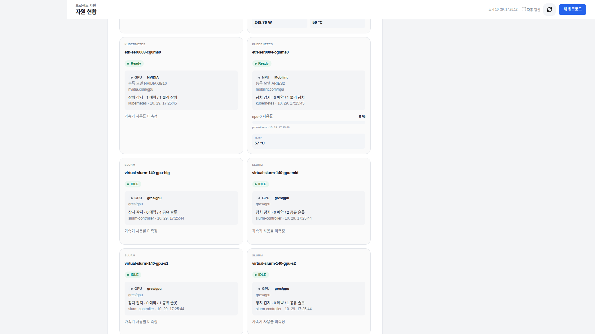
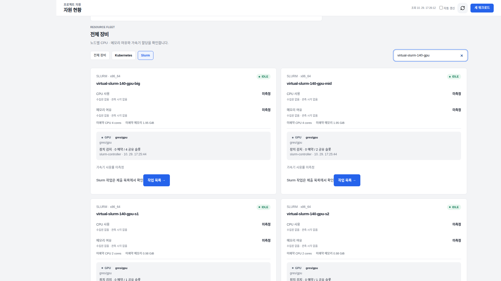
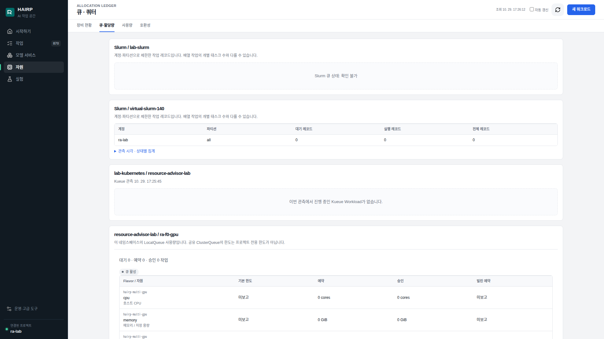
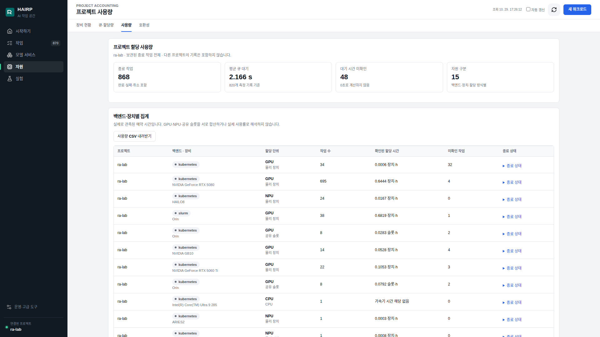

# 실제 포털 화면 캡처

2026-10-29 **17:26–17:27 KST**에 실행 중인 HAIRP / Resource Advisor 포털을 브라우저에서 직접 캡처했다. 화면 내부의 수집 시각은 별도로 표시되며, 캡처 시각과 같지 않을 수 있다.

- [캡처 모음 PDF](screenshots.pdf) · [단일 파일 HTML](screenshots.html)
- 원본: **1920 × 1080 PNG 6장**. 합성·수치 수정·이미지 후처리 없음.
- 인증 정보를 보관하지 않은 별도 브라우저 세션에서 `ra-lab` 익명 데모 화면을 조회했다. 탭 이동·스크롤·검색 필터만 사용했다.
- 새 작업 제출, CPU/GPU 벤치마크, 배포·클러스터 설정 변경은 하지 않았다.
- 주소창·인증 설정 화면은 캡처하지 않았다. 이미지에 토큰·비밀번호·사설 IP가 보이지 않는 것을 확인했다.
- 이 캡처는 **화면 연결 및 관측 표시 증거**다. 성능 개선·장애 복구 성공·가상 Slurm 작업 실행을 입증하지 않는다.

## 1. 통합 자원 현황

**설명:** Kubernetes 노드, 기존 Slurm 이력, 새 가상 Slurm 노드가 한 화면에 표시된다. UI는 `16/20 nodes ready`, `3 clusters`, GPU 등록 노드 10, NPU 등록 노드 5를 표시한다. 이는 혼합 인벤토리의 **등록 노드 수**이며, 물리 GPU 수나 현재 실행 가능한 NPU 수가 아니다. 20개에는 stale 상태인 기존 Slurm 2노드도 포함된다.

**발표 멘트:** “서로 다른 백엔드에서 수집한 자원 상태를 공통 화면에 모았습니다. 가상 자원과 과거 기록이 포함되므로 물리 장치 수와 구분해서 읽습니다.”

## 2. Kubernetes GPU·NPU 관측과 예약량

**설명:** Jetson Orin 공유 슬롯, Hailo NPU 물리 장치, Rockchip의 스케줄 불가 상태와 별도의 예약량 패널을 보여 준다. 센서 관측이 없는 장치는 `미측정`으로 표시된다. 화면에 남아 있는 AGX 상태를 읽었을 뿐, AGX에 별도 작업을 수행하지 않았다.

**발표 멘트:** “장치 등록, 예약량, 실제 사용률은 각각 다른 정보입니다. 사용률이 없으면 0으로 채우지 않고 미측정으로 남깁니다.”

## 3. Mobilint ARIES2와 가상 Slurm 슬롯

**설명:** Mobilint ARIES2의 Kubernetes 장치 등록과 Prometheus 사용률·온도 관측을 표시한다. 아래에는 가상 Slurm의 GPU 슬롯 4/2/1/1과 `IDLE`, `사용률 미측정`이 함께 보인다. Mobilint의 화면상 0%는 해당 관측 시점 값이며 추론 성능 측정값이 아니다.

**발표 멘트:** “국산 NPU도 별도 장치 클래스로 표시하고 센서 출처와 관측 시각을 함께 제공합니다. Slurm의 가상 슬롯에는 실제 GPU 사용률을 만들어 넣지 않습니다.”

## 4. 가상 Slurm GPU 노드 필터

**필터:** `Slurm` 선택 후 검색어 `virtual-slurm-140-gpu`. 화면의 검색어와 선택 상태도 원본에 남아 있다. CPU 노드와 기존 stale Slurm 노드는 이 필터의 대상이 아니다.

**설명:** 가상 GPU 노드 4개의 이름과 `IDLE`, GRES 공유 슬롯을 보여 준다. 아래 행 일부는 브라우저 뷰포트 밖에 있으며, 전체 슬롯 4/2/1/1은 3번 캡처에서 확인할 수 있다. 실제 GPU 연산이나 제출 worker 활성화를 뜻하지 않는다.

**발표 멘트:** “Slurm에서 읽은 GRES와 노드 상태를 공통 자원 모델에 매핑했습니다. 이 환경은 연결 시연용 가상 클러스터입니다.”

## 5. Slurm 큐와 Kubernetes Kueue 관측

**설명:** 기존 `lab-slurm`의 확인 불가와 새 `virtual-slurm-140`의 정상 조회를 구분한다. 가상 Slurm 조회는 `ra-lab` 계정·`all` 파티션 범위이고, 대기·실행·전체 레코드는 모두 0이다. Kubernetes 쪽에는 관측된 진행 중 Kueue Workload가 없다는 상태가 표시된다. 공통 화면의 대기 수와 native 큐 레코드는 집계 대상·상태 의미가 달라 일치한다고 가정하지 않는다.

**발표 멘트:** “Kueue와 Slurm의 원래 정책은 유지하고, 각 시스템이 보고하는 큐 상태와 조회 범위를 공통 화면에서 설명합니다.”

## 6. 프로젝트 사용량 집계

**설명:** 현재 프로젝트에 보관된 **과거 종료 작업**의 집계 화면이다. Kubernetes·Slurm, GPU·NPU, 물리 장치·공유 슬롯을 구분하고 미확인 시간을 별도로 표시한다. 화면의 Slurm Orin 사용량은 과거 실행 이력이며, 새 가상 Slurm의 실행 성과가 아니다. CPU 항목 역시 기존 이력이며 이번 캡처에서 CPU 작업을 실행하지 않았다. 평균 큐 대기 등 화면 수치는 새 정책 비교 실험 결과로 사용하지 않는다.

**발표 멘트:** “단순 사용률 그래프와 별도로 할당 시간 장부를 관리합니다. 물리 장치 시간과 논리 슬롯 시간은 합산하지 않고, 누락된 구간도 드러냅니다.”

## 재현 방법

1. 기존 데모 포털에서 `자원 → 장비 현황`을 연다. 브라우저 뷰포트를 1920 × 1080으로 설정한다.
2. 최상단, GPU·NPU 관측소, Mobilint 카드 위치로 순서대로 스크롤해 저장한다.
3. `전체 장비 → Slurm`을 선택하고 `virtual-slurm-140-gpu`를 검색해 저장한다.
4. `큐·할당량`, `사용량` 탭에서 상단 화면을 저장한다. 제출·취소 버튼을 누르지 않는다.
5. 시각과 값은 새 관측에 따라 달라진다. 이번 원본 PNG의 해시는 `artifact-manifest.json`에 기록돼 있다.

캡처 모음 HTML/PDF는 [README의 생성 명령](README.md#산출물-재생성)으로 원본 PNG에서 다시 생성한다. 원본 PNG 자체는 실행 중인 포털을 다시 캡처해야 한다.
