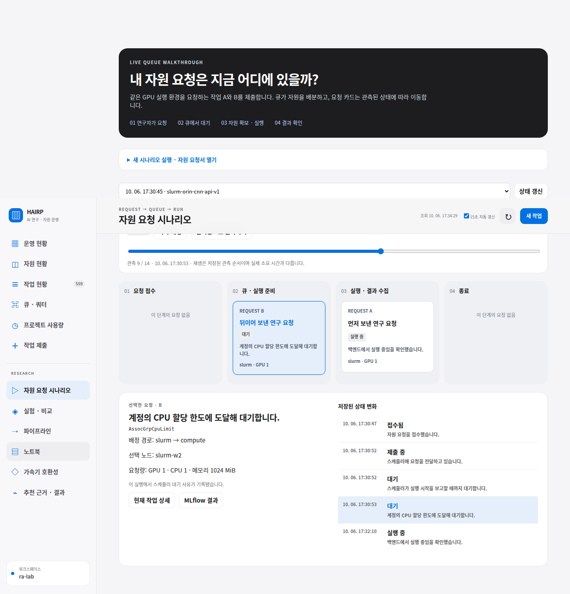
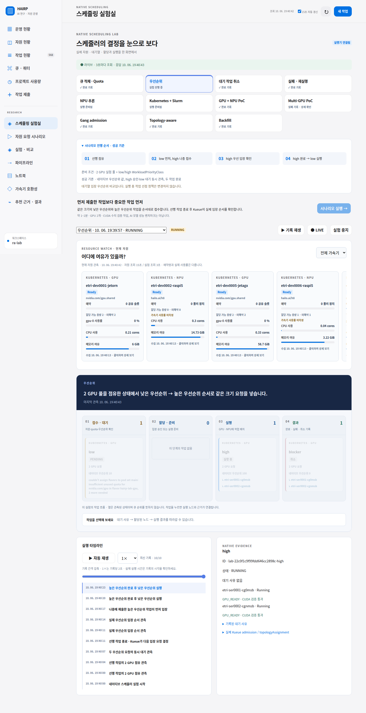

# 작업 대기 → 실행 시나리오: 과거 화면 원본

2026-10-06에 저장된 화면입니다. 현재 상태나 새 실험 결과가 아닙니다. 이미지 픽셀은 원본 그대로 보존했습니다.

## 자원 요청 시나리오

[원본 이미지 열기](01-request-wait-run.png)

A가 실행되는 동안 B가 대기하는 화면과 저장된 상태 이력을 보여줍니다. 해당 실행 기록은 Slurm Orin CNN 작업이며, B의 대기 사유는 계정 CPU 할당 한도 `AssocGrpCpuLimit`입니다. GPU 부족이나 Kueue 실행 증거로 해석하지 않습니다.

- [실행 기록 및 동작 설명](../../../reference/queue-scenario.md)
- 원본: `.state/resource-advisor/queue-scenario/scenario-final-desktop.png`

## 스케줄링 실험실: 우선순위

[원본 이미지 열기](02-kueue-priority.png)

낮은 우선순위 작업 `low`가 대기하고 높은 우선순위 작업 `high`가 실행 중인 Kueue 시나리오의 저장 화면입니다. 화면에는 실행 단계, 관측 이력 재생, Native Evidence가 있습니다. 정지 화면 하나로 전체 실행 순서나 실험 성공을 추가 판정하지 않습니다. 화면의 일부 이력 문구와 현재 카드 상태는 다르게 보이므로 발표에서는 관측 시점의 대기·실행 카드 구분에 사용하십시오. KAI 검증 증거가 아닙니다.

- [실험실 구현 및 검증 설명](../../../reference/native-scheduler-lab.md)
- 원본: `.state/resource-advisor/native-scheduler-lab/scenario-pack/priority-live.png`

