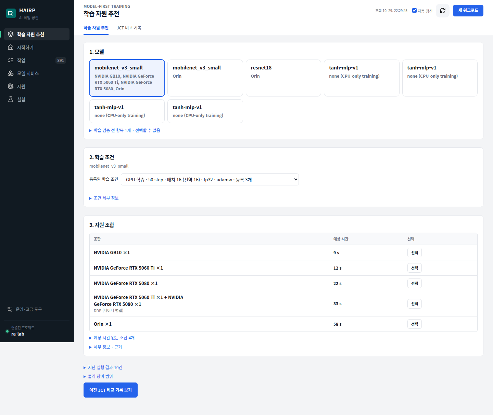
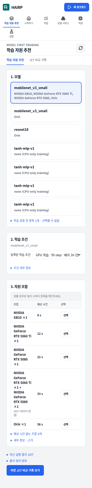

# 자원 선택 화면 간소화 (2026-10-29)

배포: http://10.254.192.47:18420/console#training

기본 목록은 자원 조합, 예상 시간, 선택의 세 열이다. 계산된 시간을 오름차순으로 표시하며, 미계산 항목·측정 근거·실행 이력은 접힌 상세 영역에 보존한다. 선택은 작업·자원·예상시간 계산 정책을 실행 화면으로 전달한다. 작업을 자동 제출하지 않으며 기존 검증 및 보조 NPU 예약 조건을 유지한다.

검증: training catalog 19개 테스트 통과, JavaScript 문법 검사 통과. 기존 브라우저 fixture에서 미계산 항목 분리, 정책 전달, 갱신 후 상세 영역·포커스 유지 확인. LAN 배포 화면 1440px/390px 확인, 모바일 문서 너비 390px. GB10 단일 선택은 실행 검토 통과; 배포 화면의 GPU 2개 선택은 ddp-rtx5060-rtx5080과 vt-final-profile-queue-network-20261029를 정확히 전달했다. 선택 시 scheduling-plans 조회만 발생하고 학습 작업은 제출하지 않았다.

독립 리뷰: Standards 초기 상세 영역 상태 결함 수정 후 0건. Spec 초기 미계산 항목 분리·상세 영역 상태 결함 수정 후 0건. 실제 브라우저에서 발견한 정책 전달 문제도 수정했다.

이미지는 기존 운영 이미지에 console.js와 console.css만 추가한 sha256:ee1fadf939743b6227ca44be344581d3f592eda68476e750e4fde51b2d8f3a8e다. 운영 응답의 두 파일 해시가 배포 파일과 일치하며 API rollout 완료를 확인했다.

## 배포 화면 캡처

### PC (1440px)

### 모바일 (390px)

