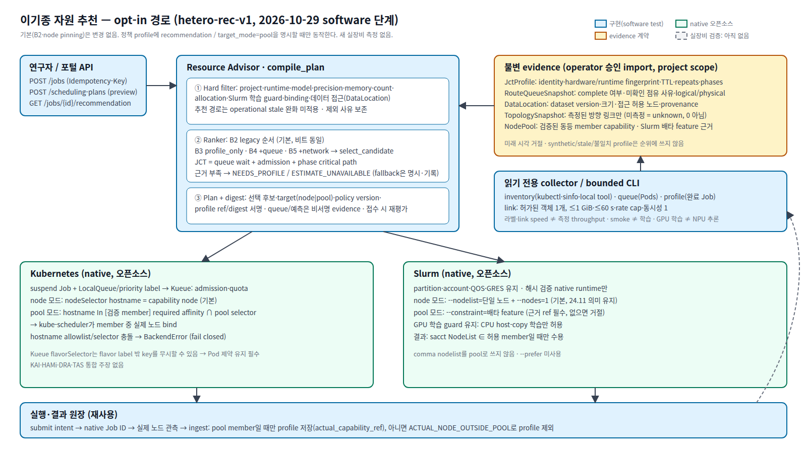

# 02. 아키텍처 — opt-in 이기종 추천 경로

기준: 브랜치 `feat/heterogeneous-recommendation`(base `2a528dd`), 2026-10-29. 증거 수준은 **코드 존재 + software test 통과**까지다. 새 실장비 실행·측정은 없다.

원본: [architecture.svg](architecture.svg) (1600×900, 16:9).

## 1. 경계

| 계층 | 담당 | 이 작업에서 바뀐 것 |
|---|---|---|
| Resource Advisor `compile_plan` | 호환성·정책 hard filter, 후보 순위, plan digest | 정책 profile에 `recommendation`/`target_mode`를 명시한 경우에만 새 ranker·pool target 사용 |
| Kueue | admission·quota (LocalQueue/ClusterQueue) | 없음 |
| kube-scheduler | Pod의 최종 노드 bind | pool 모드에서 검증 member 중 노드 선택 |
| Slurm | partition·account·QOS·GRES·할당 | pool 모드에서 배타 feature 안에서 노드 선택 |
| 실행·결과 원장 | submit intent, reconcile, 결과 검증, usage | pool 결과의 실제 노드 결합 |

기본 경로(정책에 두 필드가 없음)는 정렬·plan·digest·profile 서명이 기존과 같다. `SchedulingPolicy`의 serializer가 None/`node` 값을 직렬화하지 않으므로 기존 profile digest가 바뀌지 않는다(`test_legacy_profile_signature_and_plan_are_unchanged_by_the_opt_in_fields`).

## 2. 요청 → 결정 → native Job 연결

1. `POST /jobs`(자동 선택) 또는 `POST /scheduling-plans` 미리보기 → `compile_plan`.
2. hard filter: 기존 `execution_compatibility`(project·runtime·model·precision·shape·environment·capacity·reservation·검증 수준), 정책(backend·allocation·자원 상한·priority·binding), Slurm 학습 guard, **추천 경로에서는 operational stale 완화 미적용**, `DataLocation`이 있으면 접근 허용 노드만, pool 모드면 `NodePool` 검증. 모든 제외 사유는 `excluded`와 `evaluation`에 남는다.
3. ranker: `recommendation`이 없으면 기존 순서. 있으면 [`recommendation.rank`](../../../src/resource_advisor/recommendation.py)가 evidence를 고정 입력으로 바꿔 [`select_candidate`](../../../src/resource_advisor/jct_selection.py)를 호출한다.
4. plan: `recommendation`(policy·version·status·선택 후보·fallback·profile ref/digest·data location·topology ref)은 **digest 대상**, `recommendation_evidence`(예측·queue snapshot·전송 추정·평가 시각)는 digest 밖이다. 접수(`Service.submit`) 때 다시 컴파일하므로 근거가 바뀌어 선택·profile이 달라지면 `SCHEDULING_PLAN_CHANGED`로 거절된다.
5. 같은 Idempotency-Key 재요청은 기존 job을 반환한다(새 선택·제출 없음). 승인·project 격리·Slurm guard는 기존 규칙 그대로다. 별도 제출 경로를 만들지 않았다.
6. worker가 native Job을 만들면 `external_id`가 기록된다. `GET /jobs/{id}/recommendation`이 저장된 결정, plan digest, 제외 후보, target, native Job ID, 실제 placement·allocation, native 시각을 한 번에 돌려준다.

## 3. Pool target (opt-in)

2026-10-29 공식 문서 조사(저장소 밖 비공개 scratch `native-boundary-research.md`; Kubernetes node assignment·RuntimeClass, Kueue v0.19.5 ResourceFlavor/flavorassigner, Slurm 24.11 sbatch)를 따랐다. 핵심: Kueue flavor 매칭은 hostname allowlist의 가용성을 증명하지 않으며, Slurm 24.11의 comma nodelist는 "member 중 하나"가 아니다.

- `NodePool`은 operator가 등록한 member capability 목록이다. 모든 member는 대표 capability와 fingerprint(arch·vendor·model·device class·allocation·resource key·runtime versions·environment digest·memory model·power mode, backend·cluster)가 같아야 한다. 하나라도 다르면 `POOL_MEMBER_INCOMPATIBLE`, 등록되지 않았으면 `POOL_UNDECLARED`로 실패한다(label에서 추론하지 않음).
- 준비되지 않았거나 stale·용량 부족인 member는 허용 목록에서 빠지고, 남은 member가 없으면 `POOL_NO_VERIFIED_MEMBER`.
- Kubernetes: hostname selector 대신 `kubernetes.io/hostname In [member]` required node affinity + pool selector label. 단일 term이라 OR로 넓어지지 않는다. 설정된 hostname allowlist·selector와 충돌하면 `BackendError`.
- Slurm: `--nodelist` 대신 `--constraint=<feature>`. feature가 정확히 member만 고른다는 근거 ref가 없으면 거절한다. comma nodelist·`--prefer`는 쓰지 않는다. partition/account/QOS/GRES와 GPU 학습 guard(CPU host-copy만)는 그대로다.
- 결과: Kubernetes Pod `nodeName`, Slurm `sacct NodeList`가 member일 때만 결과·profile을 받아들이고 `actual_capability_ref`를 기록한다. 밖이면 `ACTUAL_NODE_OUTSIDE_POOL`로 profile에서 제외한다(Slurm은 결과 자체 거절).

## 4. 새 모듈과 변경 파일

| 파일 | 내용 |
|---|---|
| `src/resource_advisor/recommendation.py` | evidence 계약, pool 해석, evidence→selector adapter, ranker, collector 변환, linkage |
| `src/resource_advisor/jct_selection.py` | phase critical path, `profile_queue_network`(staging 대체) |
| `src/resource_advisor/scheduling.py` | opt-in 필드, freshness guard, data 접근 filter, pool target, ranker hook |
| `src/resource_advisor/backends.py` | pool 모드 manifest/script/result |
| `src/resource_advisor/service.py` | pool 결과의 실제 노드 결합 |
| `src/resource_advisor/api.py` | evidence import(operator) 4종, `GET /jobs/{id}/recommendation` |
| `src/resource_advisor/hetero_collect.py`, `examples/hetero_collect.py` | 읽기 전용 collector와 bounded link probe |
| `src/resource_advisor/hetero_experiment.py`, `examples/hetero_experiment.py` | 고정 계획·runner·분석 |

## 5. 구분

| 수준 | 항목 |
|---|---|
| 구현 + software test | 위 표 전체 |
| native 오픈소스 기능(재사용) | Kueue admission, kube-scheduler bind, Slurm 할당·feature constraint |
| 실장비 검증 | **없음** (이번 단계는 Job 제출·운영 변경 금지) |
| 계획 | [07-EXPERIMENT-PLAN.md](07-EXPERIMENT-PLAN.md)의 실장비 실행 |
