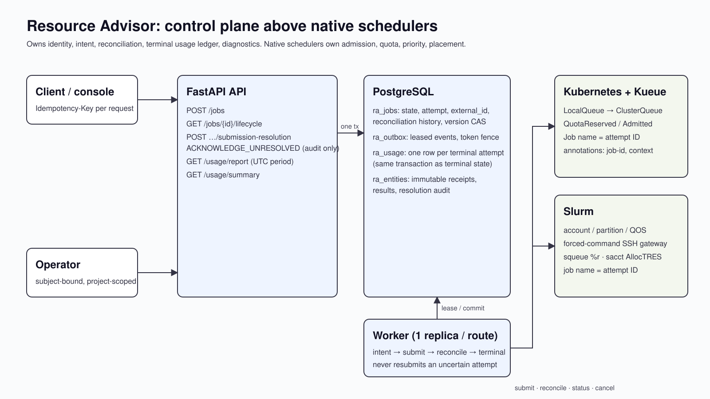
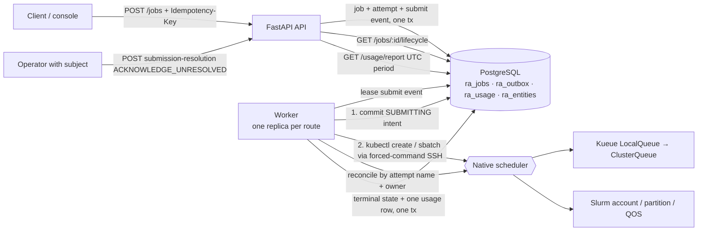

# Integrated operations: architecture and responsibility boundaries

Resource Advisor is a control plane **above** existing native schedulers. It owns
logical job/attempt identity, durable intent, reconciliation, the terminal usage
ledger and diagnostics. Kubernetes/Kueue and Slurm own admission, quota,
priority, placement and execution. Nothing here schedules GPUs.

## Lifecycle contract

| Boundary | Durable state | Recovery |
|---|---|---|
| API accepted | `VALIDATED` job, attempt ID, `submit-<attempt>` outbox event | Same key replays same job/attempt; different body is a conflict |
| Before native call | `SUBMITTING` committed | Crash ⇒ lease expiry ⇒ reconcile, never submit |
| Native call outcome | `QUEUED` + `external_id`, or `SUBMISSION_UNKNOWN`, or `FAILED` + `native_rejection` | Only an allow-listed refusal of the submit command is terminal |
| Reconcile | `submission_reconciliation` (checks, last outcome, consecutive no-match, last 10) | `MATCHED` adopts; `NO_MATCH`/`AMBIGUOUS`/`QUERY_FAILED` keep the attempt open |
| Operator | immutable `submission_resolution` entity + job flag `ACKNOWLEDGED` | Audit only; reconciliation continues and a late match is adopted |
| Terminal | state + `ra_usage` row in one transaction (attempt PK) | Replay/backfill inserts nothing new |

## Accounting contract

- Ledger rows are reservations observed from native evidence (Kubernetes scheduled
  container requests + Pod timestamps; Slurm `sacct` AllocTRES + offset times),
  never requested resources and never utilization.
- `/usage/report` clips `[started_at, backend_finished_at]` to a UTC `[start, end)`
  period. Unknown interval/count ⇒ counted unknown, not zero. Non-terminal
  attempts are listed as `not_finalized` and excluded from totals.
- Groups never combine clusters, device classes, allocation modes
  (`physical_device`, `virtual_slot`, `cpu_only`), accelerator models or resource
  keys (MIG profiles and NPU keys stay separate). No exchange rate is invented.
- Institution scope is a trusted operator credential's explicit project list; it
  widens reporting only, never job access.

## Policy contract

Project routes map to one Kueue LocalQueue or one Slurm account/partition/QOS set
in the private worker config; `verify_adapter_plan` rejects drift before submit.
Lifecycle diagnostics classify the persisted native reason without changing it:
`QUOTA_OR_LIMIT_PENDING` (Kueue `QuotaReserved=False … insufficient`, Slurm
`AssocGrp*/QOSGrp*/QOSMax*`), `CAPACITY_PENDING`, `PRIORITY_PENDING`,
`NODE_OR_ADMIN_UNAVAILABLE`, `EVICTED_OR_PREEMPTED`, `NATIVE_REJECTED`,
`UNCLASSIFIED`, `UNKNOWN`. Pending on quota is not rejection; no global fairness
or quota is added.

## Concurrency qualification

Optimistic version CAS on every transition, lease-token fencing and PostgreSQL
`SKIP LOCKED` claims have software tests with concurrent claimants. Operational
qualification remains **one worker replica per route** (`replicas: 1`,
`Recreate`). This is not an HA claim.
