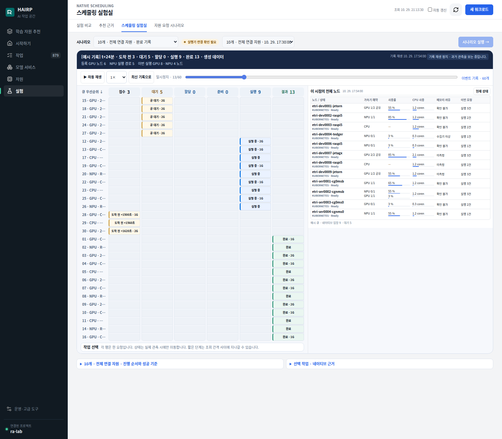
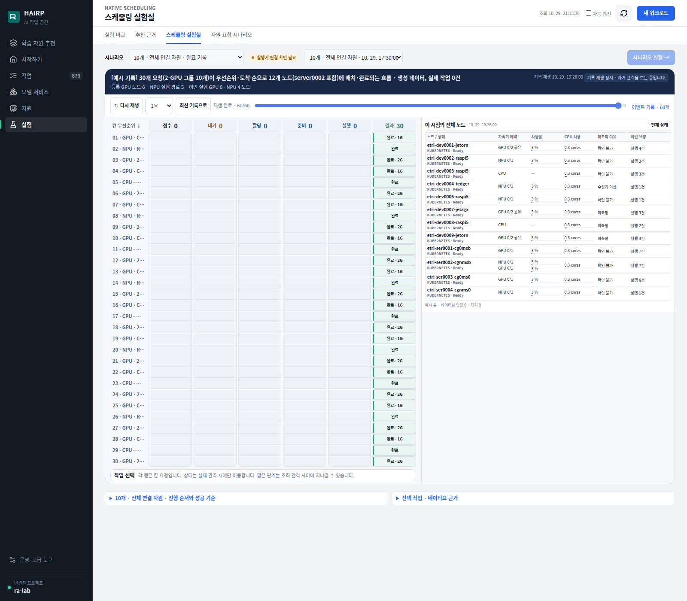

# 전체 장비 요청 재생 캡처

2026-10-29 기존 스케줄링 실험실에서 캡처한 예시 기록입니다.
0002를 포함한 12개 장비, 요청 30개, 우선순위 및 1·2 GPU 요청의 배정 흐름을 보여줍니다.
실제 GPU 사용이나 작업 실행 없이 생성한 재생 데이터입니다.

## 대기 큐와 작업 배정

타임라인 t+24분: 도착 전 3개, 대기 5개, 실행 9개, 완료 13개.

## 완료

요청 30개가 완료된 마지막 프레임.

기존 시나리오 선택기의 고정 이름에는 ‘10개’가 남아 있지만, 이 예시 기록은 요청 30개입니다.
