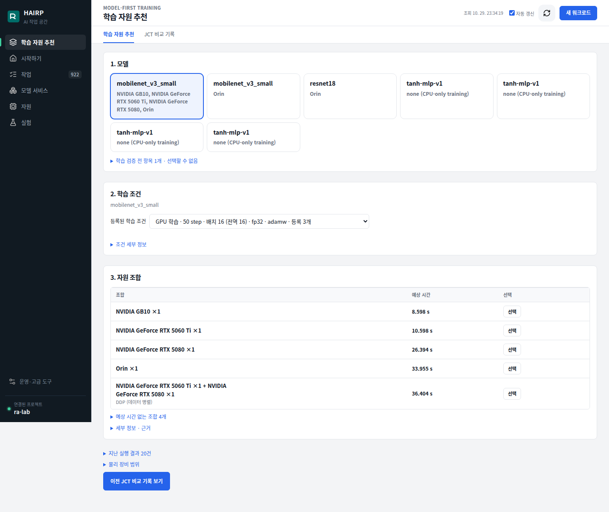
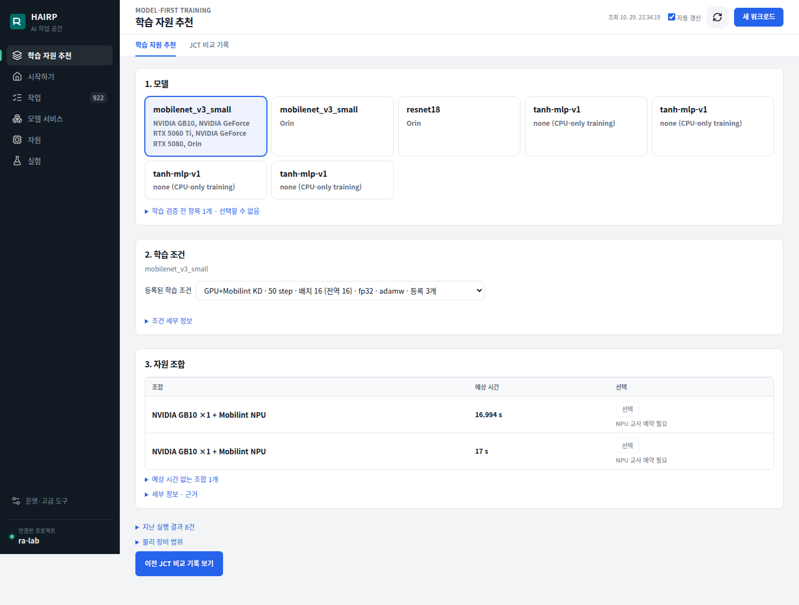

# 전체 자원 조합 5회 추가 측정 — 2026-10-29

사용자 요청에 따라 기존 측정 및 직전 Orin 단독 재실행을 제외하고, 6조합을 각각 정확히 5회 추가 실행했다. 총 30회가 모두 성공했고 품질 검증도 통과했다. PostgreSQL의 네이티브 실행 시각과 MLflow 30개 FINISHED run을 확인했다.

| 조합 | 1~5회 JCT (초) | 평균 (초) | 최소~최대 (초) | 평균 학습 연산 (초) |
|---|---|---:|---:|---:|
| GB10 (Spark) | 8, 9, 9, 9, 8 | 8.6 | 8~9 | 1.014 |
| RTX 5060 Ti | 10, 10, 12, 11, 10 | 10.6 | 10~12 | 0.707 |
| RTX 5080 | 28, 18, 19, 29, 38 | 26.4 | 18~38 | 0.586 |
| Orin | 33, 32, 39, 32, 33 | 33.8 | 32~39 | 5.596 |
| RTX 5060 Ti + RTX 5080 (DDP) | 39, 34, 35, 43, 31 | 36.4 | 31~43 | 4.749 |
| GB10 + Mobilint ARIES2 (KD) | 17, 17, 17, 17, 17 | 17.0 | 17~17 | 9.118 |

JCT는 네이티브 스케줄러 제출부터 실행 종료까지다. 초 단위 네이티브 타임스탬프를 사용한다. Mobilint 5회가 모두 17초인 것은 이 기록 해상도에서의 값이다.

조건: MobileNet V3 Small, 전역 배치 16, 50 optimizer step, FP32, AdamW, 동일한 데이터셋 및 초기 가중치. 같은 GPU를 공유하는 단일·DDP 작업은 겹치지 않게 실행했다. 서로 다른 장비는 병렬로 진행했다. 데이터는 각 작업의 임시 공간에 전송했다.

GPU 25회는 기존 Network-Aware 정책에 후보를 고정하고 실행 전 예측을 기록했다. 종료 직후 큐 관측이 불완전하면 새 작업을 만들지 않고 관측 갱신 후 다시 계획했다. 실패한 계획은 실행 횟수에 포함하지 않았다.

GB10+Mobilint는 CE+KD 목적함수의 공동 작업이므로 일반 GPU 학습과 목적함수가 다르다. 종료된 교사를 동일한 모델·이미지로 재생성하고 새 UID에 연결된 등록 항목을 사용했다. 기존 17초 프로파일을 새 등록 항목의 예측으로 복사하지 않았으며, 5회는 고정 후보 Static 경로로 실행해 실측을 기록했다. 각 작업의 50회 교사 호출과 합계 250회를 확인했다. 교사 프로세스는 사전 준비 상태이며, 재생성 비용은 위 JCT에 포함되지 않는다.

측정 후 임시 교사 Pod를 삭제하고 추가했던 worker 실행 경로를 제거했다. 이 측정은 실행시간 반복 확인이며 A/B/C/D 정책 우열 비교가 아니다.

[작업별 원시 결과](evidence/jct-repeat5-20261029/results.json) · [MLflow 확인](evidence/jct-repeat5-20261029/mlflow-checks.json) · [GPU+NPU 실행 근거](evidence/jct-repeat5-20261029/joint-teacher-proof.json)

## 5회 실측 기반 예상 JCT 보정

2026-10-29 추가 측정 30건으로 기존 `jct_profile_from_jobs`를 재사용해 조합별 5회 프로파일 6개를 등록했다. 이전 한 번의 시작 지연이 크게 반영됐던 Orin은 평균 실행 단계 비용 33.8초로 보정됐다. Network-Aware 예측은 여기에 최신 전송 관측을 대체 적용해 33.955초로 표시됐다. 네트워크와 준비 시간을 중복 합산하지 않았다.

| 조합 | 보정 후 포털 예상 JCT |
|---|---:|
| Orin | 33.955초 |
| GB10 | 8.598초 |
| RTX 5080 | 26.394초 |
| RTX 5060 Ti | 10.598초 |
| RTX 5060 Ti + RTX 5080 | 36.404초 |
| GB10 + Mobilint (새 등록) | 16.994초 |

기존 실행 당시의 예측·오차 기록은 변경하지 않았다. 위 값은 5회 측정 후 보정한 현재 예측이며, 추가 실행 없이 등록·조회·브라우저 표시를 검증했다. 네트워크 receipt는 서로 다른 임시 캐시의 신원을 유지하도록 각 실제 관측별로 35개 등록했고, 새 공동 작업의 데이터 위치도 연결했다. 새 Mobilint 등록의 PROFILE_RUNTIME_MISMATCH가 해소되어 5회 근거의 숫자 예측이 표시된다.

구버전 staged-v1의 네 GPU 등록은 다른 코드·이미지에 해당하고, 초기 KD-v1은 전송 비용을 분리할 수 없다. 이 과거 중복 등록에 새 런타임의 실측을 복사하지 않았다. 현재 측정한 여섯 조합은 모두 ESTIMATED 상태다.

[보정 프로파일과 조회 결과](evidence/jct-repeat5-20261029/calibrated-profiles.json)

