# 현재 MLOps 구조와 검증 범위

현재 저장소는 검증된 두 feature 선형 모델에 대해 **실제 GPU 학습 → 독립 평가 →
MLflow 등록 → KServe 서빙 → 이전 버전 롤백**을 연결했다. 일반 모델 전체를
지원하는 운영용 MLOps 플랫폼은 다음 단계다. 아래 구조와 증거가 현재 설명할 수 있는 범위다.

```mermaid
flowchart LR
    P[운영자: 불변 학습·평가 정책] --> J[사용자: 학습 요청 / Job·Attempt]
    J --> K[Kueue admission / Kubernetes GPU 실행]
    K --> S[S3 checkpoint와 학습 receipt 검증]
    S --> E[CPU holdout 평가]
    E --> G{고정 quality gate}
    G -->|미달| Q[QUALITY_REJECTED / 등록 차단]
    G -->|통과| M[MLflow 명시적 version 등록]
    M --> D[운영자: 배포 명령 / 불변 이력]
    D --> V[Worker: 소유권·7파일 hash·lineage 검증]
    V --> C[불변 model ConfigMap]
    C --> I[KServe CPU predictor]
    I --> R[실제 generation·Pod 계약·예측 확인]
    R --> A[READY receipt / 인증 prediction API]
    A --> B[운영자: 이전 READY 배포 선택]
    B --> D
```

| 경계 | 직접 구현한 책임 | 기존 도구의 책임 |
| --- | --- | --- |
| 요청 → 실행 | project 권한, workload/runtime 계약, 동일 요청 재시도, Job/Attempt 추적 | Kueue quota·admission, Kubernetes node binding·실행 |
| 실행 → 모델 | checkpoint/S3 검증, 독립 holdout 평가, 사전 고정 gate, run/version lineage | MLflow 실험·파일·명시적 모델 버전 저장 |
| 모델 → 서빙 | 등록·소유권·파일 hash 재검증, 제한된 predictor 명세, durable outbox와 native 쓰기 충돌 방지 | KServe ISVC → Deployment/Service reconcile |
| 배포 → 성공 | 실제 Pod 실행·보안 계약, 현재 generation·replica·model identity·예측 검증 | Kubernetes rollout 상태와 Service 연결 |
| 복구 | 이전 READY 모델을 새 불변 명령으로 재배포하고 다시 검증 | KServe와 Kubernetes의 새 spec rollout |

API, worker, predictor를 분리했다. 사용자는 임의 Pod 명세나 모델 코드를 넘기지 않는다.
Worker가 모델 파일과 native 변경을 검증하며, predictor는 검증된 JSON weights를
플랫폼의 고정 loader로 계산한다. Predictor에는 Kubernetes API token, MLflow/S3/DB
자격 증명이 없다. 현재 predictor는 cluster-local이며, API 인증과 cluster 내부의
강한 tenant 네트워크 격리는 별개의 경계다.

서비스별 불변 predecessor→successor 기록으로 동시 명령을 조정한다. Kubernetes
resourceVersion과 revision으로 오래된 쓰기를 차단한다. API 재시도는 같은 명령을
반환하고, rollout 중이거나 model identity가 다르면 prediction API가 503을 반환한다.
READY는 실제 검증 시점의 receipt이며 지속적인 건강 상태를 대신하지 않는다.

## 실제로 확인한 결과

2026-10-12에 모델 버전 **1 → 2 → 1**을 같은 서비스에서 배포·롤백했다. 각 단계의
64개 예측값이 CPU 평가 결과와 일치했고, ISVC·Deployment·Service UID를 유지했다.
첫 이름 길이 실패도 이력에 남기고 복구했으며, 성공 이력을 지우지 않았다.
모델 2는 추가 GPU 학습으로 등록했고 MLflow의 명시적 버전 다운로드와 7파일 hash를
검증했다. 배포·롤백에서는 새 학습 Job을 만들지 않았다.

두 버전은 같은 deterministic 예제로 학습하여 checkpoint와 예측값이 같다.
다른 run/policy/package lineage와 실제 version identity로 전환을 확인했다.
정확도 향상, 성능 향상, A/B 실험 결과를 주장하는 근거는 아니다.

Python 3.11/3.13 CI에서 각각 SQLite 1,230개와 PostgreSQL 1,241개 테스트가 통과했다.
배포 관련 집중 테스트 19개, 두 독립 리뷰, 실환경 검증을 별도로 수행했다.
기존 Job/usage 861개와 사용자 수정 파일 36개를 보존했으며, 최종 Job 862개는
모두 종료 상태다. 완료된 시험 Pod는 남아 있지 않다.

상세 계약은 [학습·평가·등록](reference/model-lifecycle.md)과
[서빙·롤백](reference/model-serving.md), 실제 값은
[서빙 검증 기록](evidence/model-serving-20261012-v1.json)에서 확인한다.

## 면접에서 설명할 수 있는 문장

“기존 Kubernetes·Kueue·MLflow·KServe를 연결하면서 각 도구 사이의 모델 전달 계약을
직접 구현했습니다. 학습 결과의 hash와 lineage를 검증하고 CPU holdout gate를
통과한 명시적 모델 버전만 배포합니다. 배포 성공은 리소스 생성만으로 처리하지 않고
실제 Pod 명세와 모델 identity, 예측 결과로 확인합니다. 불변 이력과 재시도 처리를
통해 이전에 검증한 버전으로 롤백하는 경로까지 실환경에서 확인했습니다.”

## 남은 단계

- 이 모델 lifecycle 전체를 실행하는 KFP workflow와 console의 모델 lineage 화면.
- 지속적인 서빙 상태·latency·error·drift 관측과 기준에 따른 재학습/자동 복구.
- 일반 binary 모델과 큰 checkpoint, GPU inference, canary traffic 전환.
- 운영용 HA, 자동 인증서 갱신, package 보존·삭제 정책, 강한 tenant 격리.

기존 Kubeflow → compute API → GPU 실행 경로의 검증은 있다. 이번 모델 lifecycle
전체를 KFP에서 오케스트레이션했다고 설명하려면 그 통합을 추가로 검증해야 한다.
