# 현재 MLOps 구조와 검증 범위

현재 저장소는 검증된 두 feature 선형 모델에 대해 **KFP 학습 → 평가·MLflow 등록 →
기존 모델과 비교 → 별도 staging 검증 → 운영자 승인 → 기존 서비스 배포**를
연결했다. 이전 READY 버전으로 롤백하는 경로도 있다. 일반 모델과 운영용 HA는
다음 단계다. 아래 구조와 실환경 증거가 현재 설명할 수 있는 범위다.

```mermaid
flowchart LR
    P[운영자: 학습·릴리스 정책과 현재 기준 버전 고정] --> J[KFP 사용자 권한: 학습 요청 / Job·Attempt]
    J --> K[Kueue admission / Kubernetes GPU 실행]
    K --> S[S3 checkpoint와 학습 receipt 검증]
    S --> E[CPU holdout 평가]
    E --> G{고정 quality gate}
    G -->|미달| Q[QUALITY_REJECTED / 등록 차단]
    G -->|통과| M[MLflow 명시적 version 등록]
    M --> L[고정 후보와 같은 holdout 기준 품질 비교]
    L --> T[별도 staging ISVC / 세 번의 실제 예측 검증]
    T --> W[PENDING_APPROVAL / KFP 완료]
    W --> O[운영자: 검증 digest·사유·actor를 묶은 승인]
    O --> D[승인·증거 유효기간·현재 기준 버전 확인 후 배포]
    D --> V[Worker: 소유권·7파일 hash·lineage 검증]
    V --> C[불변 model ConfigMap]
    C --> I[KServe CPU predictor]
    I --> R[실제 generation·Pod 계약·예측 확인]
    R --> A[READY receipt / 인증 prediction API]
    A --> B[운영자: 이전 READY 배포 선택]
    B --> D
```

| 경계 | 직접 구현한 책임 | 기존 도구의 책임 |
| --- | --- | --- |
| 요청 → 실행 | project 권한, workload/runtime 계약, 동일 요청 재시도, Job/Attempt 추적 | Kueue quota·admission, Kubernetes node binding·실행 |
| 실행 → 모델 | checkpoint/S3 검증, 독립 holdout 평가, 사전 고정 gate, run/version lineage | MLflow 실험·파일·명시적 모델 버전 저장 |
| 후보 → 릴리스 | 학습 전 고정 정책, 같은 평가 기준의 회귀 gate, 별도 staging과 불변 검증 기록 | KFP의 task 의존 관계·재시도·실행 이력 |
| 승인 → 배포 | 사용자/운영자 권한 분리, 정확한 검증 digest 승인, 만료·stale baseline·직접 우회 차단 | 기존 배포 worker와 KServe reconcile |
| 모델 → 서빙 | 등록·소유권·파일 hash 재검증, 제한된 predictor 명세, durable outbox와 native 쓰기 충돌 방지 | KServe ISVC → Deployment/Service reconcile |
| 배포 → 성공 | 실제 Pod 실행·보안 계약, 현재 generation·replica·model identity·예측 검증 | Kubernetes rollout 상태와 Service 연결 |
| 복구 | 이전 READY 모델을 새 불변 명령으로 재배포하고 다시 검증 | KServe와 Kubernetes의 새 spec rollout |

API, worker, predictor를 분리했다. 사용자는 임의 Pod 명세나 모델 코드를 넘기지 않는다.
Worker가 모델 파일과 native 변경을 검증하며, predictor는 검증된 JSON weights를
플랫폼의 고정 loader로 계산한다. Predictor에는 Kubernetes API token, MLflow/S3/DB
자격 증명이 없다. 현재 predictor는 cluster-local이며, API 인증과 cluster 내부의
강한 tenant 네트워크 격리는 별개의 경계다.

서비스별 불변 predecessor→successor 기록으로 동시 명령을 조정한다. Kubernetes
resourceVersion과 revision으로 오래된 쓰기를 차단한다. API 재시도는 같은 명령을
반환하고, rollout 중이거나 model identity가 다르면 prediction API가 503을 반환한다.
READY는 실제 검증 시점의 receipt이며 지속적인 건강 상태를 대신하지 않는다.
릴리스 정책 등록과 신규 배포는 같은 서비스 잠금으로 직렬화한다. 보호가 등록되는
중간에 직접 배포가 통과할 수 없고, 학습 후에 등록한 정책으로 후보를 승인할 수도 없다.
승인 기록의 actor는 서버 설정 principal이며 독립적인 사람 신원 확인을 뜻하지 않는다.

## 실제로 확인한 결과

2026-10-12에 모델 버전 **1 → 2 → 1**을 같은 서비스에서 배포·롤백했다. 각 단계의
64개 예측값이 CPU 평가 결과와 일치했고, ISVC·Deployment·Service UID를 유지했다.
첫 이름 길이 실패도 이력에 남기고 복구했으며, 성공 이력을 지우지 않았다.
모델 2는 추가 GPU 학습으로 등록했고 MLflow의 명시적 버전 다운로드와 7파일 hash를
검증했다. 배포·롤백에서는 새 학습 Job을 만들지 않았다.

두 버전은 같은 deterministic 예제로 학습하여 checkpoint와 예측값이 같다.
다른 run/policy/package lineage와 실제 version identity로 전환을 확인했다.
정확도 향상, 성능 향상, A/B 실험 결과를 주장하는 근거는 아니다.

2026-10-13에는 사용자 권한만 사용하는 실제 KFP workflow가 새 GPU 학습 한 번으로
버전 3을 등록하고 별도 staging 검증 후 승인 대기에서 멈췄다. 세 probe에서 각각
64개 예측이 저장된 평가와 정확히 일치했다. 기존 서비스는 승인까지 버전 1을 유지하고,
별도 운영자 배포 요청 후 버전 3으로 전환했다. 같은 키로 KFP를 다시 실행해도
GPU Job·후보·검증·배포를 중복 생성하지 않았다. 이 후보도 같은 deterministic
예제여서 MSE는 기존 버전과 같다. 정확도 개선을 주장하지 않는다.

Python 3.11/3.13 CI에서 각각 SQLite 1,252개와 PostgreSQL 1,263개 테스트가 통과했다.
두 독립 리뷰의 잔여 지적은 없다. 기존 Job/usage 862개와 사용자 수정 파일 36개를
보존했고, 최종 Job 863개는 모두 종료 상태다. 이번 KFP 완료 Pod 10개는 로그를
보관한 뒤 삭제했다. 학습 Pod는 로그 보관 후 이미 사라진 상태였으며 Job은 보존했다.

상세 계약은 [학습·평가·등록](reference/model-lifecycle.md)과
[서빙·롤백](reference/model-serving.md), [승인 기반 릴리스](reference/model-release.md)에 있다.
실제 값은 [이전 서빙 검증](evidence/model-serving-20261012-v1.json)과
[KFP·승인·배포 검증](evidence/model-release-20261013-v1.json)에서 확인한다.

## 면접에서 설명할 수 있는 문장

“기존 Kubernetes·Kueue·MLflow·KServe를 연결하면서 각 도구 사이의 모델 전달 계약을
직접 구현했습니다. KFP는 사용자 권한으로 학습과 별도 staging 검증을 수행하고
승인 대기에서 끝납니다. 운영자는 고정된 모델과 검증 digest를 승인하며, 배포할 때
증거 만료나 기준 버전 변경을 다시 확인합니다. 같은 키의 workflow 재실행은 GPU
학습을 중복 생성하지 않습니다. 실제 Pod 계약·모델 identity·예측 결과로 배포를
확인하고, 기존 READY 버전으로 롤백하는 경로도 실환경에서 검증했습니다.”

서빙 관측은 API 요청 수·지연·오류와 30초 실제 예측 probe로 연결했다.
입력 PSI는 고정 학습 데이터와 최근 사용자 요청의 분포를 비교하며,
가용성·오류율·p95·입력 변화에 대한 Prometheus 알림 규칙을 제공한다.
[서빙 모니터링의 동작과 한계](serving-observability.md)를 참고한다.
전체 회귀·장애·알림 전달 검증은 사용자 요청에 따라 후속 작업으로 남겼다.

## 남은 단계

- Console의 모델 lineage·승인·릴리스 화면.
- 서빙 관측의 SLO·drift 기준 보정, 장애·알림 검증 및 기준에 따른 재학습/자동 복구.
- 일반 binary 모델과 큰 checkpoint, GPU inference, canary traffic 전환.
- 운영용 HA, 자동 인증서 갱신, package 보존·삭제 정책, 강한 tenant 격리.

Staging과 기존 서비스는 같은 lab namespace를 사용한다. 이번 KFP 실행은 실제
cluster API로 연결하는 임시 TLS bridge를 사용하고 종료 후 제거했다. 상시 자동 실행에는
Service DNS에 맞는 TLS endpoint와 인증서 관리가 필요하다. 세 probe는 smoke 검증이며
운영 SLO·부하 시험을 대신하지 않는다. 지속적인 서빙 탐지는 별도 monitor가 수행하며,
현재 내부 Service DNS 연결에는 기존 CA와 IP SAN 검증을 유지하는 TLS 이름 설정을 사용한다.
