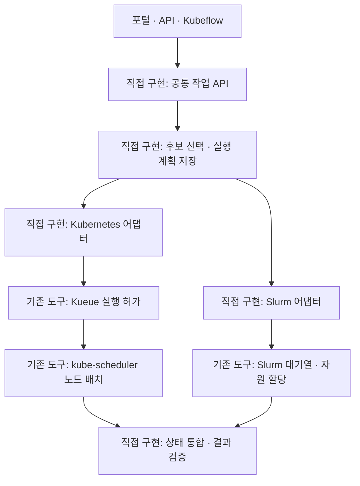

# Kubernetes와 Slurm을 하나의 작업 흐름으로 연결한 방법

면접 PPT 편집용 원고 · 2026-10-28. 본문 5장과 질문 대비 메모로 구성한다. 각 장의 ‘화면 본문’만 PPT에 넣고, 설명과 코드 근거는 발표자 노트에 둔다. Kubeflow·포털은 요청 진입점으로 작게 표시한다.

## 1장 — 서로 다른 실행 환경을 공통 작업 API로 연결

### 화면 본문

**한 번 접수하고, 실행 환경에 맞게 제출하고, 같은 기준으로 결과를 확인합니다.**

- 공통 API: 작업·자원 요구·실행 정책을 접수
- 상위 관리 계층: 검증된 실행 후보를 선택하고 실행 계획을 저장
- 어댑터: 계획을 Kubernetes Job 또는 Slurm 배치 스크립트로 변환
- 기존 스케줄러: 각 환경의 할당 한도와 실행 조건을 집행

### 그림 배치

맨 위에 요청 진입점, 가운데에 직접 구현한 공통 계층, 아래에 독립된 두 실행 경로를 놓는다. 두 경로에서 결과가 공통 계층으로 돌아오는 화살표를 넣는다. ‘직접 구현’과 ‘기존 도구 활용’을 글자로도 구분한다.

### 발표 멘트

“Kubernetes와 Slurm은 작업을 제출하는 형식도, 상태를 확인하는 방법도 다릅니다. 그래서 공통 API에서 작업을 받은 뒤, 실행 계획을 각각의 형식으로 변환하도록 구현했습니다. 아래에서는 각 스케줄러가 자기 자원의 할당과 실행을 관리하고, 위에서는 작업 상태와 결과를 같은 형식으로 확인합니다.”

### 코드 근거

- [공통 어댑터 인터페이스](../../src/resource_advisor/backends.py): `SchedulerBackend`의 `validate / submit / reconcile / status / cancel / result`
- [작업 실행 워커](../../src/resource_advisor/worker.py): `Worker.backend`가 프로젝트와 클러스터에 허용된 경로를 선택
- [정책 기반 계획](../../src/resource_advisor/scheduling.py): `compile_plan`

## 2장 — 위에서는 ‘어디로 보낼지’를 결정

### 화면 본문

**실행 가능한 후보를 걸러낸 뒤, 정책과 관측 상태에 따라 실행 대상을 선택합니다.**

| 단계 | 확인하는 내용 | 만들어지는 결과 |
|---|---|---|
| ① 실행 가능 여부 | 작업·런타임·장치 호환성, 자원 상한, 허용된 실행 경로 | 적격 후보와 제외 사유 |
| ② 후보 비교 | 관측 여유 → backend 선호 → 진행 중 접수 수 → 최근 5분 접수 수 | 선택한 후보 |
| ③ 계획 저장 | 클러스터·노드·자원량·우선순위·시간 제한·queue/QOS | 실행할 때 다시 확인할 계획 |

하단 한 줄: **실행 대상을 정해도 즉시 실행되는 것은 아닙니다. 실제 할당은 아래 스케줄러가 승인합니다.**

### 그림 배치

‘등록된 후보들 → 부적격 후보 제외 → 남은 후보 비교 → 실행 계획’ 4개 상자를 가로로 둔다. 실제 측정 사례처럼 보이는 가짜 노드 이용률·가중 점수는 넣지 않는다.

### 발표 멘트

“먼저 이 작업을 실행할 수 있는 장치와 런타임인지 확인합니다. 그다음 관측된 여유와 운영 정책, 이미 접수된 작업 수를 순서대로 비교합니다. 선택한 노드와 자원 요구량을 계획에 남기고 어댑터로 전달합니다. 다만 이것은 예약이 아니므로, 그사이 자원이 부족해지면 실제 실행 환경에서는 대기할 수 있습니다.”

### 설명할 때 정확히 구분할 점

- 자동 선택 요청은 `SchedulingProfile`로 후보를 비교한다. 후보를 직접 지정하는 경로도 있다.
- 위 기준은 가중 점수 합산이나 AI 예측이 아닌 순차 비교 규칙이다. 마지막 동률은 후보 식별자로 정한다.
- 가용성 비교는 `available → busy → unknown` 순이며, down/draining/fail 등 사용 불가로 관측된 후보는 제외한다. 관측 누락을 ‘여유 있음’으로 취급하지 않는다.
- 현재 구현은 후보의 **특정 노드까지 선택**한다. K8s에는 hostname `nodeSelector`, Slurm에는 `--nodelist`로 제약을 전달한다. 아래 스케줄러가 모든 노드 중에서 다시 자유롭게 고른다고 설명하면 부정확하다.
- 서로 다른 backend의 쿼터를 하나로 합쳐 예약하거나 공통 선점 알고리즘을 집행하는 구현은 아니다.

근거: [scheduling.py](../../src/resource_advisor/scheduling.py)의 `availability`, `compile_plan`, `verify_adapter_plan`; [기존 상세 설명 3.4절](SOURCE-MATERIAL.md#34-상위-스케줄링-계층-무엇을-보고-어디까지-결정하는가).

## 3장 — Kubernetes에서는 Kueue와 kube-scheduler가 나눠 처리

### 화면 본문

**Kueue는 ‘시작해도 되는가’, kube-scheduler는 ‘조건에 맞게 노드에 배치할 수 있는가’를 판단합니다.**

| 순서 | 담당 | 실제 처리 |
|---|---|---|
| ① 요청 변환 | 우리 Kubernetes 어댑터 | 이미지·CPU·메모리·가속기 요청량·대상 노드·LocalQueue를 Job에 작성 |
| ② 대기 상태로 제출 | 우리 어댑터 → Kubernetes API | `suspend: true`인 Job을 `kubectl create`로 생성 |
| ③ 실행 허가 | Kueue | 연결된 ClusterQueue의 쿼터와 정책에 따라 admission 처리 |
| ④ Pod 생성·배치 | Job controller → kube-scheduler | Job이 재개되면 Pod 생성, 노드 제약과 실제 자원 조건을 확인해 바인딩 |
| ⑤ 실행·관측 | kubelet / 우리 워커 | 컨테이너 실행, Job·Pod 상태와 결과 수집 |

### 그림 배치

큰 흐름은 ‘Job 제출 → Kueue 허가 → Pod 생성·노드 배치 → 실행’ 4칸으로 표현한다. Kueue 아래에 ‘큐·쿼터’, kube-scheduler 아래에 ‘노드 제약·배치’를 적는다. 우리 어댑터는 왼쪽, 상태·결과 회수는 오른쪽에 표시한다.

### 발표 멘트

“Kubernetes 쪽은 실행을 잠시 멈춘 Job으로 제출합니다. 어떤 큐에 들어갈지와 필요한 자원, 대상 노드를 함께 기록합니다. Kueue가 쿼터와 정책을 확인해 실행을 허가하면 Job의 Pod가 만들어지고, kube-scheduler가 노드 조건을 확인해 배치합니다. 따라서 Kueue의 허가와 실제 컨테이너 시작은 서로 다른 단계입니다.”

### 코드와 용어 근거

- [backends.py](../../src/resource_advisor/backends.py): `KubernetesBackend.manifest`, `submit`, `status`.
- 실제 필드: `kueue.x-k8s.io/queue-name`, `spec.suspend`, `resources.requests/limits`, `nodeSelector`. `spec.nodeName`으로 scheduler를 우회하지 않는다.
- LocalQueue는 namespace 안의 접수 큐이며 ClusterQueue에 연결된다. [프로젝트 큐 설정 예](../../deploy/projects/lab-project-b.yaml).
- [Kueue 역할](https://kueue.sigs.k8s.io/docs/overview/): 쿼터와 작업 admission을 관리하며 Pod-to-node 배치는 kube-scheduler의 책임이다.
- [Kubernetes 노드 지정](https://kubernetes.io/docs/concepts/scheduling-eviction/assign-pod-node/): nodeSelector 조건은 scheduler가 지켜야 할 배치 제약이다.

## 4장 — Slurm에서는 기존 큐·계정 정책으로 실행

### 화면 본문

**같은 작업 요청을 Slurm이 이해하는 배치 스크립트로 바꿉니다.**

| 순서 | 담당 | 실제 처리 |
|---|---|---|
| ① 요청 변환 | 우리 Slurm 어댑터 | partition·account·QOS·대상 노드·CPU·메모리·GRES를 `#SBATCH`로 작성 |
| ② 제출 | SSH → `sbatch --parsable` | 제출된 Slurm Job ID를 받아 공통 작업 ID와 연결 |
| ③ 대기·할당 | Slurm | 계정 한도·우선순위·가용 자원에 따라 대기하거나 할당 |
| ④ 실행 | Slurm / `srun` | 할당된 노드에서 검증된 실행 명령 수행 |
| ⑤ 상태·결과 회수 | 우리 어댑터 | `squeue`·`sacct`로 상태 확인, 실행 로그에서 결과 수집 |

하단 한 줄: **Kueue는 Kubernetes 경로에만 적용됩니다. Slurm 경로는 Slurm이 직접 관리합니다.**

### 그림 배치

3장과 같은 방향·간격으로 ‘스크립트 제출 → Slurm 대기열 → 자원 할당·실행 → 상태·결과 회수’를 둔다. ‘SSH’는 제출 화살표의 작은 라벨로 표시한다. 스케줄링 엔진처럼 크게 그리지 않는다.

### 발표 멘트

“Slurm 쪽은 같은 자원 요구를 배치 스크립트로 변환해서 SSH를 통해 sbatch에 제출합니다. 이후 실행 순서와 자원 할당은 기존 Slurm 정책을 따릅니다. 우리 워커는 Slurm Job ID로 대기 사유와 실행 상태를 확인하고, 종료 뒤 결과를 공통 형식으로 가져옵니다. 기존 Slurm을 Kubernetes 안으로 옮기는 방식은 아닙니다.”

### 실제 관리 화면에 연결할 사례

R10은 저장된 관측에서 `AssocGrpCpuLimit` 사유로 대기했다. 이는 Slurm association의 그룹 CPU 한도와 관련된 대기 사유다. 이후 RUNNING → COLLECTING → SUCCEEDED를 확인할 수 있다. ‘GPU 부족’이라고 바꾸어 설명하지 않는다.

- [작업 상세 캡처](management/captures/03a-workload-detail-R10.png)
- [동시점 대기열 캡처](management/captures/04-queue-snapshot-12.png): 2026-10-07 저장 관측 화면
- [구현](../../src/resource_advisor/backends.py): `SlurmBackend.script`, `call`, `submit`, `status`, `result`
- [Slurm 역할](https://slurm.schedmd.com/overview.html), [Slurm 대기 사유](https://slurm.schedmd.com/job_reason_codes.html)

## 5장 — 두 환경의 상태와 결과를 하나로 관리

### 화면 본문

**제출 방식은 달라도, 사용자는 같은 작업 상태와 결과를 확인합니다.**

- 상태 통합: 두 backend의 관측을 공통 요청의 대기·실행·수집·완료 상태로 반영
- 중복 방지: 같은 요청 키를 재사용하고, 제출 응답이 불명확하면 기존 작업부터 조회
- 결과 검증: 종료 코드뿐 아니라 작업 식별·서명·해시·품질 계약 확인
- 기록 연결: 검증 결과와 사용량 원장, S3·MLflow 게시 상태를 추적

### 그림 배치

왼쪽의 ‘Kubernetes 관측’, ‘Slurm 관측’ 화살표를 가운데 ‘공통 상태·결과 검증’으로 모은다. 오른쪽에 [워크로드 관리 캡처](management/captures/03-workloads.png)를 둔다. 장치 모델·backend·상태·결과 열에 강조 테두리를 그린다.

### 발표 멘트

“연구자가 Kubernetes와 Slurm 명령어를 따로 사용하지 않아도 작업 상태를 확인하도록 했습니다. 제출 응답이 끊기면 무조건 다시 실행하지 않고 이미 들어간 작업인지 확인합니다. 실행이 끝나도 결과가 이 요청의 것인지, 품질 조건을 만족하는지 확인한 뒤 완료를 기록하고 결과 저장과 실험 추적을 연결합니다.”

### 증거와 범위

| 보여줄 증거 | 입증하는 내용 | 출처 |
|---|---|---|
| 2026-10-07 완료 10건: K8s 8·Slurm 2 | 서로 다른 backend의 실행 상태·결과를 공통 기록으로 관리 | [원본 관측](replay/observations.json) |
| 2026-10-08 Mobilint 성공 1건 | Mobilint 실제 실행 결과를 합본 관리 화면에 함께 표시 | [고정 커밋 jobs[0]](https://github.com/dsa04156/resource-advisor/blob/a5d1dde87b56ba2794dc6a93559342eb85f1940f/docs/evidence/all-accelerators-20261008-v1.json) |
| 동일 요청 키로 KFP 재실행 시 계산 작업 1건 유지 | 반복 요청을 기존 작업과 연결한 사례 | [KFP 실행·재실행 증거](../evidence/kubeflow-pipeline.json) |

위 세 근거는 서로 다른 실행이다. 11건을 모두 같은 Kubeflow 실행으로 소개하지 않는다. 관리 캡처는 저장된 실제 기록을 새 화면으로 재구성했으며 관측 날짜가 표시되어 있다. Mobilint 근거는 Kubernetes 경로를 확인하며 해당 기록만으로 Kueue admission을 주장하지 않는다.

코드 근거: [worker.py](../../src/resource_advisor/worker.py)의 `submit_one`·`reconcile` 호출 및 상태 조정, [service.py](../../src/resource_advisor/service.py)의 `submit`·`ingest`.

## 질문 대비 — 짧게 답하는 문장

| 예상 질문 | 답변 |
|---|---|
| 직접 만든 핵심은 무엇인가요? | 공통 작업 계약·API, 정책에 따른 실행 후보 선택, Kubernetes/Slurm 어댑터, 상태 조정과 결과 검증을 구현했습니다. |
| 새로운 스케줄러를 만든 건가요? | 실행 후보와 대상 노드를 고르는 상위 정책 계층을 구현했고, 실제 쿼터 집행·배치·할당은 Kueue·kube-scheduler·Slurm을 활용했습니다. |
| Kueue와 kube-scheduler는 왜 둘 다 필요한가요? | Kueue는 쿼터와 정책에 따른 실행 허가를, kube-scheduler는 Pod의 노드 배치를 담당합니다. |
| 이미 노드를 골랐는데 아래 scheduler가 왜 필요한가요? | 대상 노드 지정은 실행 조건입니다. 실제 자원 상황과 정책에 맞는지 확인하고 할당·바인딩하는 과정은 여전히 필요합니다. |
| Kubernetes와 Slurm이 같은 GPU를 공유하나요? | 이 구현에서는 별도 실행 경로로 관리하며 같은 GPU를 두 scheduler가 공동 소유하지 않습니다. |
| SSH가 스케줄러인가요? | SSH는 제출·조회 명령을 전달하는 통로이고, 실제 실행 순서와 자원 할당은 Slurm이 결정합니다. |
| Kubeflow는 어디에 쓰였나요? | 작업 순서 관리와 공통 API 호출에 활용했습니다. 이번 설명의 중심은 그 요청을 두 계산 환경으로 연결하고 실행을 추적하는 계층입니다. |
| 두 클러스터가 동시에 바쁘면 자동으로 옮기나요? | 접수 시 선택한 계획을 각 backend에 제출합니다. 실행 중 작업의 자동 이동이나 전역 쿼터 조정까지 구현했다고 주장하지 않습니다. |

## 편집자·Claude 전달 메모

- 본문 5장을 기본으로 하고 시간이 짧으면 3·4장을 좌우 비교 1장으로 합친다.
- PPT에서 가장 크게 표시할 문장: **위에서는 실행 대상을 선택하고, 아래에서는 각 스케줄러가 할당과 실행을 집행합니다.**
- 코드·필드 이름은 본문에서 최소화하고 상세 노트에 둔다. `admission`은 ‘실행 허가’, `adapter`는 ‘요청 형식 변환’, `reconcile`은 ‘기존 작업 확인·상태 맞추기’로 먼저 설명한다.
- Kueue에서 Slurm으로 이어지는 직렬 화살표, Kubernetes와 Slurm 사이 직접 제어 화살표, 하나의 전역 GPU 쿼터 상자는 넣지 않는다.
- 원고는 현재 저장소 코드와 기록에 근거한다. 코드 구조를 사용자의 단독 구현 이력으로 바꾸지 말고 실제 담당 범위에 맞춰 발표한다.
- Mermaid는 편집용 구조 원본이다. 최종 PPT에서는 위 그림 배치대로 도형으로 옮길 수 있다.

편집 확인: 로컬 참조 15개가 존재함을 확인했다. 구조도는 Chromium의 Mermaid 12.0.0에서 밝은·어두운 테마 모두 렌더링했고 노드 9개 및 한글 접근성 제목·설명을 확인했다. GitHub/PPT의 최종 렌더링을 검증한 것은 아니다.
