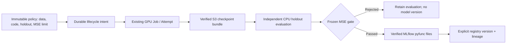

# GPU training → holdout evaluation → model registry

This opt-in path connects the existing qualified, isolated GPU training fixture
to an independent CPU evaluation and an explicit MLflow model version. A successful
compute Job alone cannot register a model. The training container's GPU/CPU numerical
agreement is distinct from holdout MSE.



## Contracts and responsibilities

- `model_lifecycle.py` owns policy/start/read and durable delivery progression.
  Existing compute submission, qualification, Kueue scheduling, result receipts,
  S3 delivery and MLflow tracking retain their responsibilities.
- `linear_model.py` predicts from two weights and a bias in a ten-step JSON
  checkpoint. The CPU worker reads the actual verified GPU output; it never trains
  a substitute model or loads executable checkpoint content.
- `model_registry.py` builds a fixed loader-module pyfunc package, uploads each
  content-addressed file, reads it back, checks run/model ownership and registers
  an explicit `models:/name/version` URI. Loader source is supplied by the platform,
  never by the workload caller.

An operator registers `POST /api/v1/compute/model-lifecycle-policies`. Policy pins
the exact WorkloadSpec digest, candidate, training input, holdout, evaluator source
digest, maximum MSE and a project-prefixed `ra-<project>-...` model name. The training
snapshot's hash must equal the qualified dataset version; feature overlap between
training and holdout is rejected. Arrays have bounded size and finite values.
Policy references are immutable. Evaluator/packaging implementation changes require
a newly qualified policy; pending old policies fail closed. Existing start retries
still return their previously accepted compute identity.

`POST /api/v1/compute/model-lifecycles`, with a retained `Idempotency-Key` and
`{"policy_ref":"your-policy"}`, stores intent before accepting the training Job.
Replaying the same request resumes any missing submission/enqueue step through the
same stable compute key. A different policy cannot reuse that key. A client crash
between these commits may leave `SUBMISSION_PENDING` or a Job without a lifecycle
delivery event until the caller replays the start. This does not duplicate compute.

`GET /api/v1/compute/model-lifecycles/{ref}` requires the owning project. It returns
Job/Attempt, training state, evaluation and registration receipts, and a sanitized
delivery error. Cross-project records return 404. Policy registration is operator-only.
These APIs inherit the deployment's configured authentication/anonymous-project
policy; they do not establish an additional MLflow authentication boundary.

The worker handles only lifecycle events routed to its compute backends. It requires
existing `artifacts`, `mlflow_url` and `mlflow_experiments` configuration; these are
the same settings used by result delivery. No new database schema or service is
required. The ordinary worker cycle performs evaluation in its CPU process after
GPU result collection and artifact/tracking delivery.

## Gate, states and retry

`TRAINING` → `WAITING_FOR_ARTIFACT` → `REGISTRATION_PENDING` → `REGISTERED`.
Training failure yields `TRAINING_FAILED`; MSE above the frozen maximum yields
`QUALITY_REJECTED`. Evaluation stores its input/output/code/policy/evaluator digests,
sample count, predictions, MSE, limit, timestamp and gate decision. A rejected
evaluation is retained in PostgreSQL and does not create a model version.

Registry/S3 outages and integrity/ownership failures leave delivery pending without
rewriting successful compute. A cached evaluation does not bypass artifact verification
on retry. The model package contains the checkpoint, fixed loader, signature,
environment declarations and a policy/evaluation lineage file. Every file has a
verified hash; the package digest is the canonical hash of that filename/hash map.

Model-version creation has no external idempotency key. Immediately before its
single POST, the worker commits a durable intent. After an uncertain response,
it searches tagged versions and validates name/source/run/tags before linking one.
An existing intent with no matching version yields `REGISTRY_RECONCILIATION_REQUIRED`
and **does not POST again**. A crash before sending that reserved POST can therefore
require manual operator investigation. Duplicate or mismatched external versions
fail closed. This is conservative reconciliation, not an exactly-once guarantee.
MLflow aliases/stages and existing versions are untouched.

## Reproduce a bounded model unit

Use a genuinely qualified linear SGD workload and the unchanged input JSON from
[training isolation](training-isolation.md). Its ten FP32 steps use eight training
rows. The public fixture below supplies 64 disjoint synthetic holdout rows and
an illustrative frozen MSE maximum of 1.0; it is a functional acceptance gate,
not a calibrated production-quality or convergence requirement.

```sh
python examples/model_lifecycle_fixture.py \
  --workload qualified-workload.json --training-input input.json \
  --policy-ref linear-lifecycle-v1 --model-name ra-your-project-linear \
  --maximum-mse 1.0 > policy.json
```

Generate this policy with the same source revision as the deployed API/worker.
Post it using the operator credential supplied outside source control, then start
with the project user's credential and a stable key. Retain the returned lifecycle
reference, poll its authenticated GET, and read `registration.model_uri` only after
`REGISTERED`. Load that exact URI with MLflow 3.16.1 and predict on a float64 `N×2`
array; output is `N×1`. Verify the actual output checkpoint digest and predictions
against the evaluation receipt.

For a negative gate test, freeze a second policy with a stricter maximum before
starting a separate bounded training request. Retain both evaluations and confirm
that the rejected lifecycle added no registry version. Do not lower an existing
policy's threshold after observing its result.

## Scope and remaining work

Only the already qualified two-feature linear GPU fixture and bounded JSON output
are supported. Operator qualification is not cryptographic hardware attestation;
synthetic envelopes are rejected, but the platform trusts qualified runtime/result
collection as elsewhere in this repository. Holdout separation is checked against
the declared immutable training input, not arbitrary undisclosed datasets.

This implementation does not promote pilot checkpoints, modify the original source,
provide arbitrary model/code uploads, transport large binary checkpoints, implement
distributed/Slurm training or convert GPU models to NPUs. The fixed model's small
synthetic dataset does not establish useful real-world model accuracy.
KFP workflow orchestration, KServe deployment/rollback and console model lineage
remain subsequent integration milestones. Storage is verified on read/write but
not WORM; independent administrators can still mutate/delete external files.

References: [MLflow custom pyfunc](https://mlflow.org/docs/latest/api_reference/python_api/mlflow.pyfunc.html),
[model registry workflow](https://mlflow.org/docs/latest/ml/model-registry/workflow/),
and the [3.16.1 loader implementation](https://github.com/mlflow/mlflow/blob/v3.16.1/mlflow/pyfunc/__init__.py).
