# Approval-based model releases

The existing qualified linear lifecycle is orchestrated by an uncached KFP
candidate workflow. Training and staging use project user credentials; production
approval and deployment are separate operator actions. The platform retains the
candidate, quality comparison, live staging verification and operator decision.

```mermaid
flowchart LR
    P[Operator freezes release policy and baseline] --> T[KFP user: train lifecycle]
    T --> E[Existing worker evaluation and explicit MLflow version]
    E --> C[KFP user: frozen release candidate]
    C --> S[Separate staging ISVC and live prediction probes]
    S --> W[PENDING_APPROVAL / workflow completes]
    W --> A[Operator: exact digest, reason and authenticated subject]
    A --> D[Operator: linked production deployment]
    D --> R[Existing worker package and native rollout verification]
    R --> B[READY receipt / emergency rollback remains available]
```



## Freeze before training

Register a new lifecycle policy as in [model lifecycle](model-lifecycle.md), then
POST `/api/v1/compute/model-release-policies` with an operator credential:

```json
{
  "ref": "release-policy-v1",
  "project_ref": "your-project",
  "lifecycle_policy_ref": "linear-policy-v1",
  "production_service_ref": "linear",
  "expected_production_deployment_ref": "mdp-current-ready",
  "maximum_mse_regression": 0.0,
  "maximum_probe_latency_ms": 10000,
  "verification_ttl_seconds": 3600
}
```

These illustrative limits are a functional acceptance policy, not a measured
production SLO. The expected ref identifies the current **desired**, READY
production deployment. Explicit null bootstraps an empty service. The platform
freezes its receipt/evaluation and compares candidate MSE on identical holdout
data and evaluator versions. Equality passes a zero-regression policy; this
does not establish model improvement. Incompatible evaluations fail closed.

Registration protects that production service against generic direct deploys.
New deployment commands require an approved release; accepted old commands can
still be replayed. Operator rollback to an earlier READY model remains available.
Protection is durable, including across policy versions; removal would require
a separately designed migration. Existing unprotected services retain their APIs.

## Candidate and staging APIs

Paths below are relative to `/api/v1/compute` and enforce project ownership.

| Method/path | Authority and behavior |
| --- | --- |
| `POST /model-releases` | User; `{policy_ref,lifecycle_ref}` and stable Idempotency-Key freeze one registered candidate |
| `GET /model-releases` | User; latest 100 release views in the project |
| `GET /model-releases/{ref}` | User; policy/baseline, lineage, staging, verification, decision, deployment and promotion blocker |
| `POST /model-releases/{ref}/staging` | User; replayable deployment to a server-generated release-specific service |
| `POST /model-releases/{ref}/verification` | User; save the first valid live staging observation |
| `POST /model-releases/{ref}/decisions` | Operator; immutable approve/reject decision for exact verification digest |
| `POST /model-releases/{ref}/deployment` | Operator; replayable production command linked to the approved release |

Staging reuses the same registered model, package readback, tokenless fixed
predictor and native rollout validation as [serving](model-serving.md). Three
authenticated prediction probes check every holdout row against the saved CPU
evaluation, maximum absolute error `1e-12` and the predeclared latency ceiling.
Latency measures the platform's prediction call, not client end-to-end latency
or concurrent load. Verification records explicit model/package identity,
staging receipt digest, probe outcomes and time. Replaying it never refreshes
the evidence lifetime. Create a new candidate when evidence expires.

## Decision and deployment

Configure a bounded `subject` in the operator principal's private credentials
JSON alongside its existing `project` and `operator` fields. Existing principals
without subject remain compatible with previous endpoints; release decisions
require it. The client cannot supply an actor. A subject identifies the configured
principal, not independently verified human identity.

```json
{
  "decision": "approve",
  "verification_digest": "sha256:REPLACE_WITH_SAVED_VERIFICATION_DIGEST",
  "reason": "Reviewed the frozen quality comparison and staging probes"
}
```

Use `signature(view.verification)` to compute the canonical digest. The decision
stores actor, reason, exact digest and server timestamp. Approve/reject is a single
immutable choice. A matching replay returns that choice; changes conflict.
Approval alone does not create a production command. The later deployment POST
checks approval, unchanged candidate/staging receipt, evidence age and production
predecessor inside the deployment transaction. Its existing successor edge
serializes competitors. A changed staging/production desired command returns 409;
expired evidence or missing approval blocks promotion. A previously accepted
deployment can still be reconciled after expiration without making a new command.

## KFP graph and launcher

Compile `examples/model_release_pipeline.py --output candidate.yaml` with the
locked SDK. `train` writes raw UTF-8 `lifecycle_ref` through `OutputPath(str)`;
`stage` consumes it and outputs `release_ref` only after saved verification.
Both tasks disable caching, allow two retries with retained API keys and request
100m CPU/128Mi, limited to one CPU/256Mi. They request no accelerator. Actual GPU
execution remains owned by the compute worker/Kueue.

Parameters are `api_url`, digest-pinned `launcher_image`, `training_policy`,
`release_policy`, `user_secret` (name only), `training_key`, `release_key` and
bounded task deadlines. The project Secret contains only its user token and CA;
the pipeline contains no operator credential or production task. Disable run-level
caching too. Use `resource_advisor.release_launcher train|stage` for the same
HTTP orchestration outside KFP. Transport failures retry the same key/body;
authorization, validation and stale-state errors fail the component.

KFP cancellation does not cancel the independently submitted lifecycle or revert
accepted serving commands. This lifecycle path has backend deadlines but does not
inherit the ordinary launcher's ownership lease. SDK 2.13.0 is locked; the lab
backend is 2.5.0. Direct run polling must handle `CANCELED` as terminal and accept
only `SUCCEEDED`; the SDK completion helper omits cancellation.

## Boundaries

The initial staging/production services share the existing lab namespace and
qualified runtime. Separate services provide logical environment separation,
not isolated production infrastructure or a hostile-tenant sandbox. This milestone
supports the existing small two-feature linear fixture. Console release controls,
continuous monitoring/drift, load testing, automated retraining/rollback, canary
traffic, model package garbage collection and HA remain later work. READY and
probe evidence describe a verification time, not ongoing availability.

References: [KFP container outputs](https://www.kubeflow.org/docs/components/pipelines/user-guides/components/container-components/),
[KFP 2.5 string conversion](https://github.com/kubeflow/pipelines/blob/2.5.0/backend/src/v2/metadata/converter.go),
[MLflow 3.16.1 registry workflow](https://github.com/mlflow/mlflow/blob/v3.16.1/docs/docs/classic-ml/model-registry/workflow.mdx).
