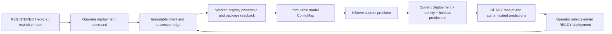

# Registered model → KServe → verified rollback

An operator explicitly deploys a quality-passed, registered model lifecycle. A
project user can read its history and call authenticated predictions. This bounded
unit serves the existing two-feature JSON linear model on one CPU replica using
KServe 0.15 RawDeployment. It does not execute arbitrary MLflow loader code.



## API and ownership

`POST /api/v1/compute/model-deployments`, operator token and stable Idempotency-Key:

```json
{"service_ref":"linear","lifecycle_ref":"mlc-your-registered-ref","expected_deployment_ref":null}
```

The first command expects null. Later commands must name the current **desired**
deployment, even when it is pending. `GET /model-services/{service_ref}` returns
the desired command and history; `GET /model-deployments/{ref}` returns the command,
receipt, state and sanitized delivery error. Project ownership is checked on all
paths. Reusing a key with different contents returns 409. A stale predecessor or
concurrent competing successor returns 409. No additional training Job is submitted.

`POST /model-rollbacks` selects an earlier READY deployment from the same service:

```json
{"service_ref":"linear","target_deployment_ref":"mdp-earlier-ready","expected_deployment_ref":"mdp-current-desired"}
```

A rollback is a new durable command, not deletion of the latest history. It works
when a newer desired rollout is pending. Quality rejection, unfinished evaluation,
an unregistered model or an unverified rollback target cannot be deployed.

`POST /model-services/{service_ref}:predict`, owning project user token:

```json
{"instances":[[0.2,0.3],[0.6,0.1]]}
```

Inputs contain 1–512 finite two-feature rows. The response has `predictions` and
explicit version/package/deployment identity in `model`. The proxy only contacts
the verified, platform-generated internal endpoint and checks identity/output.
Pending desired deployment, unavailable upstream or stale predictor identity returns
503; it cannot silently report a previous version as the current desired model.

## Worker and runtime

Add optional `serving` to existing worker configuration. Namespace, runtime image,
node selection and ServiceAccount are operator settings, never client manifest fields.
Namespaces are limited to 25 characters for the installed default KServe
`{{ .Name }}-{{ .Namespace }}` hostname label. The stable `ra-` plus 24 hex
characters reserves room for `-predictor-<namespace>` even when visibility is local.

```json
{"serving":{"project_namespaces":{"your-project":"your-model-namespace"},"image":"registry.example/predictor@sha256:REPLACE_WITH_64_HEX_DIGEST","node_selector":{"kubernetes.io/hostname":"your-cpu-node"},"service_account":"ra-predictor"}}
```

Use a qualified image containing this package and its existing API dependencies.
No additional Python dependencies are needed. MLflow configuration remains required.
The worker claims commands through the original training Job's project/backend route.
The worker Role grants namespace-scoped ISVC create/get/update, ConfigMap create/get,
and read-only Deployment/Service observations. It receives no RBAC creation or Secrets
read privilege. `deploy/worker` provides a tokenless predictor ServiceAccount with
no RoleBinding; provision equivalent namespace-scoped permissions in other namespaces.

`model_serving.py` owns operator commands, immutable successor edges and authenticated
reads/predictions. `serving_delivery.py` owns progression and registry verification.
`kserve_deployment.py` owns fenced Kubernetes writes and live verification.
`model_predictor.py` owns bounded fixed-loader package validation and KServe v1 HTTP.

The seven package files are read back from the configured same-server MLflow artifact
proxy. Model/version/run ownership, gate, saved checkpoint/evaluation lineage and all
hashes must match. The full small package is frozen in an immutable content-addressed
ConfigMap. The predictor compares its loader bytes to the platform's trusted loader
and parses JSON weights; it does not import the packaged code or access MLflow/S3/DB.
Non-root, read-only-root, capabilities drop and RuntimeDefault seccomp are explicit.

## Progression and recovery

Commands are PENDING until actual verification, READY after a saved receipt, or
SUPERSEDED when a newer desired command overtakes unfinished delivery. A READY
receipt describes its verification time; it is not continuous health monitoring.
Immutable predecessor edges serialize each service without a new database table.
Kubernetes resourceVersion and ordinal annotations fence older writes. A lost create
or update response is reconciled by reading the deterministic owned resource.

RawDeployment uses one stable `{isvc}-predictor` Service. Deployment's own observed
generation, replicas and the trusted operator runtime contract must match: image,
command/env, account/token, node, mounts/resources, non-root/read-only/capabilities
and container-level seccomp. Both ISVC readback and Deployment are compared to
the original platform manifest, including admission changes. ISVC Ready alone
is insufficient: KServe 0.15 copies Deployment observedGeneration into ISVC status.
GET predictor identity and POST holdout predictions must match before READY is saved.

Rollback reapplies the selected model package to the **InferenceService** and verifies
the resulting Deployment and predictions. Editing or rolling back the owned Deployment
directly would be overwritten by KServe reconciliation. Rolling updates may briefly
serve both versions; this is not an atomic traffic switch or canary implementation.

Failures retain PENDING/error and earlier receipts rather than inventing success.
There is no automatic rollback or continuous drift reconciliation. A resource
recreated under a different ISVC UID requires investigation. ConfigMaps and historical
deployment records are retained; automatic package garbage collection is future work.

## Verified lab run: 2026-10-12

[Verification receipt](../evidence/model-serving-20261012-v1.json) records source
`b9a323d929a939bf2b11484fcb400ef5c4b841cd`, actual registration/deployment
identities, native UID/generation/image observations and retained history.

A new qualified RTX 5080 GPU Job trained version 2 under a policy frozen before
submission (`maximum_mse=1.0`). The CPU holdout MSE was 0.4467454401311175.
Actual S3 bundle readback matched the training receipt. MLflow 3.16.1 downloaded
explicit version 2, verified all seven files and lineage, then loaded pyfunc and
matched all 64 holdout predictions with zero difference.

| Accepted operation | Model URI | ISVC / Deployment generation | Predictions vs CPU evaluation |
| --- | --- | --- | --- |
| Deploy | `models:/ra-ra-lab-linear-lifecycle-v1/1` | 1 / 1 | 64 exact matches |
| Deploy | `models:/ra-ra-lab-linear-lifecycle-v1/2` | 2 / 2 | 64 exact matches |
| Rollback | `models:/ra-ra-lab-linear-lifecycle-v1/1` | 3 / 3 | 64 exact matches |

All three operations retained the same ISVC, Deployment and Service UIDs. Each
stage ran one Ready CPU predictor on the qualified API node, with zero restarts,
no mounted API token or credentials, non-root/read-only RuntimeDefault security,
and no external Ingress/HTTPRoute. The final desired version is 1.

The first attempt exposed the default hostname-length error that admission dry-run
could not detect. Its never-ready native ISVC was removed with a UID precondition;
the immutable command remains SUPERSEDED. A new operator command recovered it.
History therefore contains four commands: one superseded failure and three READY
receipts. Replaying the three accepted commands returned their original receipts
without adding history. Cross-project reads returned 404, user mutation 403,
stale commands 409 and quality-rejected selection 422 without changing the target.

[Exact-source CI](https://github.com/dsa04156/resource-advisor/actions/runs/38240321553)
passed Python 3.11/3.13: SQLite 1,230 passed / 11 skipped and PostgreSQL 1,241 passed
in each version. Focused serving tests passed 19. Both independent review axes have
zero remaining findings, including deterministic same-key concurrency, admission,
Pod security and hostname regressions.

Both API/worker Argo applications are Synced/Healthy and their deployed source
hashes match the qualified images. All 861 prior Job/usage rows, 6,307 original
noninventory entities, 3,848 outbox identities, 33 original ConfigMaps and 36 dirty
user files were preserved. Original credentials/settings, other resource specs,
UIDs, queues and PVCs remain intact. The only added compute Job is terminal;
862 Jobs now exist. Deployment/rollback submitted no training Jobs. No completed
Pods remain. The new training Pod/logs were captured while available; native
Jobs/events/S3 bundles and all three predictor Pod/log snapshots were retained.

Both registered versions were trained with the same deterministic fixture, so
checkpoint bytes and predictions are equal. Their run/policy/package lineage
is different. This demonstrates version selection and rollback, not improved
model accuracy or an A/B experiment.

## Boundaries

`networking.kserve.io/visibility: cluster-local` suppresses external exposure for the
installed RawDeployment path. The native predictor has no application authentication;
API project authorization does not isolate arbitrary callers already inside the cluster.
Namespace-scoped create RBAC plus ownership checks is not a hostile-tenant sandbox.
Predictor images are digest-pinned but rely on operator qualification. JSON ConfigMaps
are appropriate for this tiny model only. KFP orchestration, console lineage, generic
binary models, GPU inference, canary experiments and production HA remain separate.

References: [KServe v0.15 custom predictor](https://github.com/kserve/kserve/blob/v0.15.0/docs/samples/v1beta1/custom/custom_model/custom.yaml),
[Raw status propagation](https://github.com/kserve/kserve/blob/v0.15.0/pkg/apis/serving/v1beta1/inference_service_status.go),
[Kubernetes rollout completion](https://kubernetes.io/docs/concepts/workloads/controllers/deployment/).
