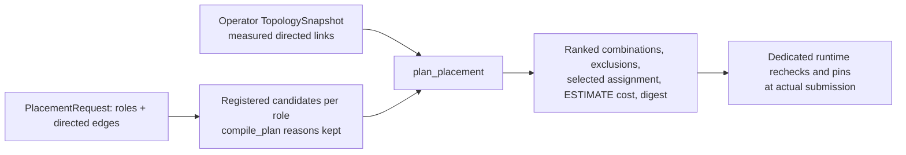

# Topology-aware role placement

`resource_advisor.placement` plans a bounded task made of up to four roles
(for example a fixed NPU forward stage feeding a GPU training stage). It ranks
combinations of registered candidates using operator-imported, measured
directed links. It is a planner only: it does not reserve, submit, pin or
authorize anything on hardware.

## Interfaces

- Pure: `plan_placement(snapshot, request, candidates, at=...)`. The native demo
  calls it with its own `ResolvedCandidate` list; same inputs and `at` give the
  same `digest`. A candidate whose `workload_ref` differs from its role's, or
  whose `candidate_ref` is outside the role's `candidate_refs`, raises
  `ValueError` before planning (the API resolver already scopes them). The plan carries `request_digest`, `candidates_digest` and the
  snapshot digest so a saved plan is bound to its inputs.
- HTTP (prefix `/api/v1/compute`):
  - `POST /topology-snapshots` — operator only; immutable per ref (409 on a
    different body); future `observed_at` is rejected.
  - `GET /topology-snapshots`, `GET /topology-snapshots/{ref}` — project
    scoped; another project's snapshot is 404.
  - `POST /placement-plans` — any project principal; read-only evaluation of a
    `PlacementRequest`. Candidates come only from the project's registered
    workload/variant/capability records through `compile_plan` with the named
    `scheduling_profile_ref`; the caller cannot add capabilities, commands,
    URLs or credentials. Nothing is persisted. Availability/headroom is kept
    only when its inventory snapshot belongs to the project and the
    capability's own backend and cluster; the legacy observation lookup keys by
    `(backend, node_ref)` only, so a same-named node in another cluster yields
    `unknown` (and its `OBSERVED_NODE_UNAVAILABLE` is dropped). If another
    cluster's newer inventory shadows the right one, the result stays
    `unknown` (fail closed); `scheduling.py` itself is unchanged.

Existing `/scheduling-plans` and `/jobs` behaviour is unchanged.

## Topology snapshot semantics

- Explicit `observed_at`, `expires_at` (≤ 7 days later), `evidence_ref`,
  `measurement_method` and `source=operator_import`.
- Endpoints are `(backend, cluster_ref, node_ref)` identities with an optional
  `physical_host_ref` and physical `device_ref`s. A device may appear on two
  endpoints only as a backend alias of one declared physical host.
- Links are **directed**: `bandwidth_bytes_per_second` (> 0, finite) and
  `request_overhead_ms`, each with its own `measured_at`. A reverse link, a
  same-host link, NVLink, rack or a self link is never inferred. Each link must
  be within `link_max_age_seconds` (default 3600) of observation and is treated
  as expired at planning time once older than that, even inside a fresh
  snapshot. Duplicate links and unknown endpoints are rejected.

## Planning rules

1. Graph bounds: ≤ 4 roles, ≤ 8 candidates per role, ≤ 4096 combinations,
   unique roles/edges, acyclic.
2. Candidate filtering precedes cost. Every candidate stays visible with its
   reasons (contract unavailable, NPU training variant not verified, profile
   limits, Slurm training isolation, queue binding, availability).
3. Roles on one physical host (or one endpoint) sum CPU, memory and
   accelerator requests. CPU/memory must fit every alias's observed headroom.
   Accelerator demand per `resource_key` must fit the headroom of the
   candidates that own that key and of any member that explicitly reports it;
   a non-owner that simply does not report the key (e.g. a GPU candidate's
   view of `mobilint.com/npu`) is ignored, so a GPU and an NPU on one node can
   co-locate. A missing owner value or an explicit `null` blocks as unknown.
4. With `require_distinct_physical_devices` (default), each accelerator role
   receives explicit distinct `device_ref`s by deterministic bounded matching
   (≤ 4 roles × ≤ 64 slots): role order with sorted device IDs, moving an
   earlier role to another eligible device only when a later role would
   otherwise be stranded. Aliased IDs are one device. Unknown identity,
   identity from an expired snapshot, virtual slots or too few distinct known
   devices exclude the combination.
5. Edge cost, labelled ESTIMATE in milliseconds:
   `transfer_count * (request_overhead_ms + bytes_per_transfer / bandwidth * 1000)`.
   Example: 1,000,000 B at 1,000,000 B/s with 2 ms overhead = 1002 ms per transfer.
6. Hard edges (`requirement=hard`) fail closed on missing/expired links and on
   `min_bandwidth_bytes_per_second`, `max_request_overhead_ms` or `same_node`
   violations. Soft edges keep the combination, record `unknowns` or
   `soft_unmet`, and rank it after fully measured alternatives.
   An expired link (or any link in an expired snapshot) keeps its old
   bandwidth/overhead/`measured_at` under `link` as historical provenance only:
   its `estimated_*_ms` is `null` and it adds nothing to
   `known_partial_communication_ms` or ranking. An expired snapshot also adds
   `TOPOLOGY_SNAPSHOT_EXPIRED` to every combination's `unknowns`, so its plans
   are never `complete`.
7. Ranking: no unknowns, fewer soft violations, fewer busy roles, lower
   estimate, profile backend order, candidate refs.
8. `selected.admission` is never "runnable now": it is
   `observed_headroom_recheck_at_submission`, `wait_for_resources` or `unknown`.

## Not provided

- Not an NCCL/DDP or general multi-stage executor; an accepted plan is not an
  atomic group reservation and no group submission endpoint exists.
- Not Slurm training qualification, a cross-backend global quota, or automatic
  model conversion. Only registered runtime variants are candidates.
- Estimates are not training time and do not show optimal hardware performance.
  Kueue topology-aware scheduling uses hostname/rack hierarchy without
  bandwidth measurement, and Slurm's topology plugin does not optimise on link
  speed; this measured-link cost model is ours, not theirs.
