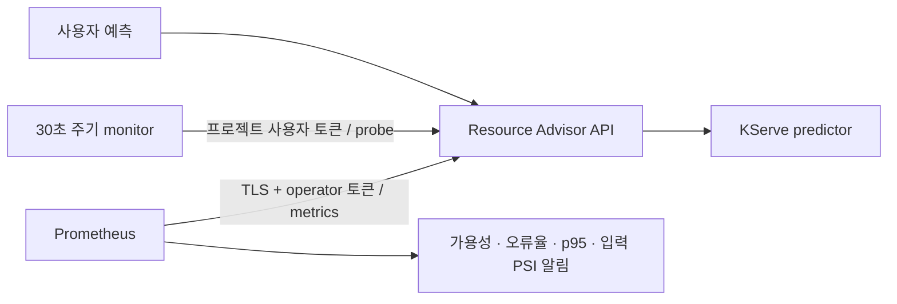

# 모델 서빙 모니터링

배포 때 기록한 `READY`와 현재 예측 서비스의 상태를 구분한다. API에서 사용자 예측의 요청 수, 지연, 실패를 수집하고, 별도 `ra-serving-monitor`가 30초마다 고정 holdout 한 행을 예측한다. Probe는 현재 desired 모델의 identity와 평가 당시 예측값을 확인한다.



## API와 실행

기존 `POST /api/v1/compute/model-services/{ref}:predict` 응답 계약을 유지한다. 다음 두 엔드포인트에는 프로젝트 소속 Bearer 토큰이 필요하다.

| 엔드포인트 | 동작 |
| --- | --- |
| `GET /api/v1/compute/model-services/{ref}/observability` | 현재 배포, 요청 집계, 마지막 probe, 입력 drift 조회 |
| `POST /api/v1/compute/model-services/{ref}/probe` | 고정 holdout 한 행으로 현재 모델을 호출하고 상태 갱신 |

Probe가 실패해도 요청 자체가 실행되면 HTTP 200 응답의 `probe.success`는 `false`다. 잘못된 인증과 타 프로젝트 서비스는 각각 401/404다. Probe는 배포 승인이나 롤백을 수행하지 않는다.

```bash
rtk proxy python -m resource_advisor.serving_monitor \
  --api-url https://ra-api.resource-advisor-lab.svc:8443 \
  --service-ref linear-serving-v1 --interval-seconds 30 \
  --tls-server-name <certificate-SAN>
```

`RA_API_TOKEN`에는 사용자 토큰, `SSL_CERT_FILE`에는 신뢰할 CA 파일 경로를 제공한다. `--once`는 한 번 실행하고 모든 probe가 성공하면 0, 실패하면 1로 종료한다. 인증·연결 실패는 토큰이나 응답 본문을 로그에 남기지 않고 재시도한다. Monitor의 readiness heartbeat는 인증된 API 응답을 받은 때만 갱신된다. Predictor 장애는 별도의 probe 지표로 드러난다.

## Prometheus

기존 operator 전용 `/metrics`에 해당 프로젝트의 서빙 지표를 추가한다. 기존 작업 지표와 operator 전역 outbox 지표의 범위는 그대로다.

| 지표 | 용도 |
| --- | --- |
| `resource_advisor_model_requests_total` | 서비스·request/probe·success/error/conflict별 요청 수 |
| `resource_advisor_model_request_duration_seconds` | 실제 predictor 호출을 포함한 API 서빙 지연 histogram |
| `resource_advisor_model_info` | 현재 desired 배포와 명시적 모델 URI |
| `resource_advisor_model_probe_success` | 마지막 실제 probe 성공 여부 |
| `resource_advisor_model_probe_timestamp_seconds` | 마지막 probe 시각; 0은 아직 실행되지 않음 |
| `resource_advisor_model_input_samples` | 현재 모델의 입력 관측 행 수 |
| `resource_advisor_model_input_psi` | 두 입력 feature의 PSI |

`deploy/serving-observability/render.py`는 digest 고정 이미지, 인증서 SAN, 프로젝트와 네임스페이스 설정으로 Deployment, ScrapeConfig, PrometheusRule을 렌더링한다. Secret 값은 출력하거나 Git에 저장하지 않는다.

```bash
rtk proxy python deploy/serving-observability/render.py \
  --image <services-image@sha256:digest> \
  --tls-server-name <certificate-SAN> \
  --service-ref linear-serving-v1 > /private/serving-observability.yaml
rtk proxy kubectl apply -f /private/serving-observability.yaml
```

설치 전에 API namespace에 `ra-serving-probe-client` Secret을 사용자 `token`, `ca.crt` 키로, monitoring namespace에 `ra-serving-metrics-client` Secret을 operator `token`, `ca.crt` 키로 준비한다. 기존 API의 `/metrics` 권한 계약 때문에 수집기는 operator 토큰을 사용한다. Monitor에는 Kubernetes 서비스 계정 토큰이나 operator 자격 증명을 제공하지 않는다. ScrapeConfig와 PrometheusRule의 `release: prometheus`는 기존 selector에 맞추고 필요하면 사이트에서 변경한다.

TLS 연결 대상은 내부 Service DNS이고 인증서 검증 대상은 `tls-server-name`/`serverName`으로 지정한다. CA와 인증서 이름 검증을 모두 유지하며 `insecureSkipVerify`를 사용하지 않는다. 기존 IP SAN 인증서를 유지하는 사이트에서도 사용할 수 있다.

알림은 scrape 실패, 실제 probe 실패, probe 갱신 중단, monitor 가용 replica 없음, 사용자 요청 오류율, p95 지연, 입력 PSI를 다룬다. 초기 기준은 오류율 5%, p95 1초, PSI 0.2이고 지연·오류율에는 최근 5분 최소 20요청 조건이 있다. 실제 트래픽에 맞는 SLO 조정은 후속 작업이다. 기존 Alertmanager 라우팅을 사용하며 새 외부 수신자는 구성하지 않는다. Probe를 설정하지 않은 서비스의 초기 시각 0은 probe 실패·갱신 중단 알림에서 제외한다.

## 입력 drift 범위와 남은 검증

고정 lifecycle policy의 `training_input.x`를 기준으로 feature별 quantile bin을 만든다. 사용자 요청에서 최근 최대 1,024행의 **bin 번호만** 메모리에 보관한다. Raw 입력이나 출력은 저장하지 않는다. 128행 전에는 `INSUFFICIENT_DATA`이고 PSI 알림은 발생하지 않는다. Probe 입력은 사용자 분포에서 제외한다. Desired 배포가 바뀌면 관측 window와 probe 상태를 새 배포 기준으로 초기화한다.

PSI는 입력 분포 변화 신호다. 정답 label이나 운영 품질 점수가 아니며 자동 재학습·승격을 유발하지 않는다. 현재 고정 2-feature 선형 모델에 적용한 구현이다. 작은 학습 기준 표본, 단변량 bin, smoothing과 임계값에 대한 통계적 적합성 검증은 이후 수행한다.

현재 배포는 API 단일 프로세스다. API 재시작 시 관측 window와 JSON 집계가 초기화되며 Prometheus가 수집한 시계열은 기존 보존 정책에 따른다. 여러 API replica/process를 사용하려면 metric aggregation과 drift window 공유를 먼저 구현해야 한다. 라벨 집합은 DB에 존재하는 서비스와 현재 모델로 제한하지만 서비스 수에 대한 별도 운영 상한은 아직 없다.

사용자 요청에 따라 기본 기능 smoke와 실제 연결 확인만 수행한다. 전체 회귀 테스트, 독립 코드 리뷰, 장애 주입, 알림 발화·복구 및 통지 전달, 장시간 운영 검증은 후속 검증으로 남긴다.
